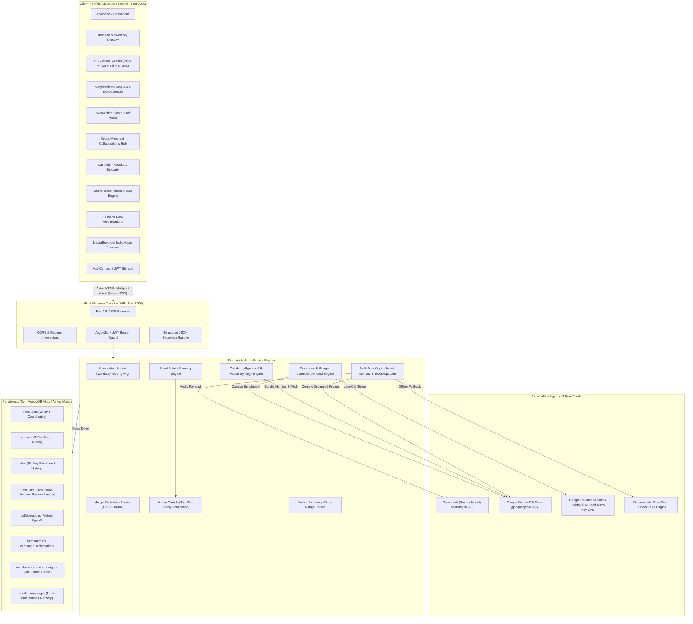
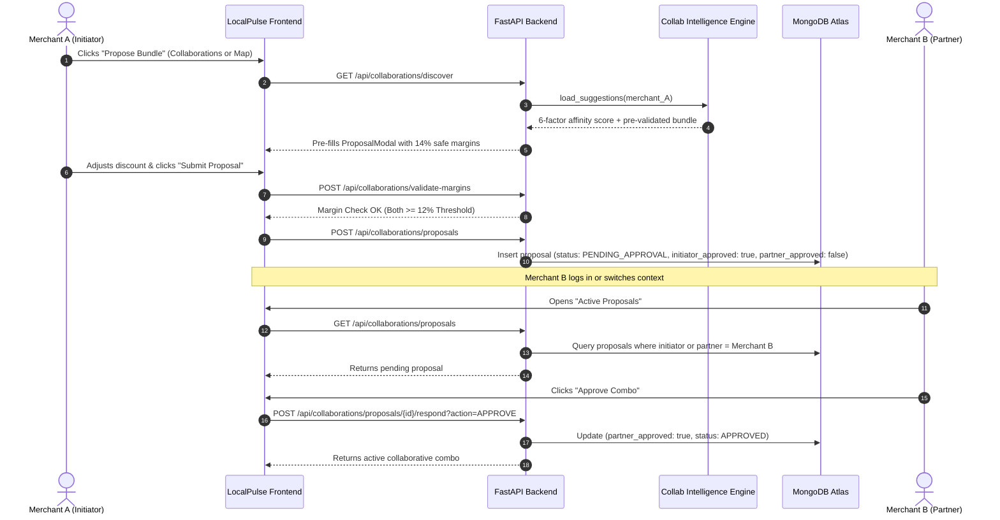
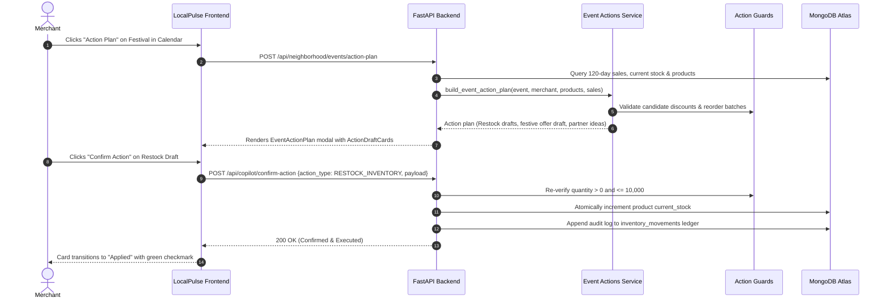
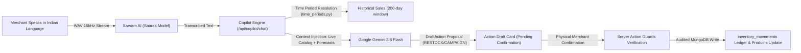

# LocalPulse AI — Hyper-Local Merchant Growth Platform

> **Hackathon Prototype** · **Paytm Build for India AI Hackathon** · *Merchant Growth AI Track*

LocalPulse AI is a production-grade, hyper-local demand forecasting and collaborative growth engine architected specifically for Indian MSMEs — kirana stores, neighbourhood cafes, organic produce marts, and retail shops. Built on modern distributed system principles, it pairs deterministic weekday-aware demand forecasting, real-time stockout prevention, audited inventory replenishment, and margin-protected multi-merchant co-promotions with an **AI Business Copilot** (featuring multilingual voice input via Sarvam AI & reasoning via Google Gemini 3.8 Flash), a **Live All-India Occasion Demand Engine** (powered by Google Calendar's continuous national holiday feed), and an **Event Action Planning & Safe Draft Execution System**.

---

## Table of Contents

1. [High-Level System Design & Architecture](#1-high-level-system-design--architecture)
2. [Domain Architecture & Core Subsystems](#2-domain-architecture--core-subsystems)
   - [A. Weekday-Aware Demand Forecasting Engine](#a-weekday-aware-demand-forecasting-engine)
   - [B. Deterministic Margin Protection Engine (12% Invariant)](#b-deterministic-margin-protection-engine-12-invariant)
   - [C. Live All-India Occasions & Google Calendar Demand Engine](#c-live-all-india-occasions--google-calendar-demand-engine)
   - [D. Event Action Planning & Safe Draft Execution Engine](#d-event-action-planning--safe-draft-execution-engine)
   - [E. Collaboration Intelligence & 6-Factor Synergy Bundles](#e-collaboration-intelligence--6-factor-synergy-bundles)
   - [F. Two-Tier Action Guards & Business Rule Verification](#f-two-tier-action-guards--business-rule-verification)
   - [G. Indic Voice-to-Text & Grounded Multi-Turn Copilot](#g-indic-voice-to-text--grounded-multi-turn-copilot)
   - [H. 3-Tier Dynamic Catalog Pricing Engine](#h-3-tier-dynamic-catalog-pricing-engine)
   - [I. Tri-Category Prioritized Operational Actions](#i-tri-category-prioritized-operational-actions)
3. [End-to-End Data Flow Architecture](#3-end-to-end-data-flow-architecture)
   - [Collaboration Proposal & Mutual Approval Lifecycle](#collaboration-proposal--mutual-approval-lifecycle)
   - [Occasion Action Plan to Audited Mutation Lifecycle](#occasion-action-plan-to-audited-mutation-lifecycle)
4. [Database & Spatial Schema Design](#4-database--spatial-schema-design)
5. [Complete API Specifications](#5-complete-api-specifications)
   - [Authentication & Tenant Context (`/api/auth`)](#authentication--tenant-context-apiauth)
   - [Neighborhood Spatial Radar & Occasions (`/api/neighborhood`)](#neighborhood-spatial-radar--occasions-apineighborhood)
   - [AI Business Copilot & Voice (`/api/copilot`)](#ai-business-copilot--voice-apicopilot)
   - [Multi-Merchant Collaborations (`/api/collaborations`)](#multi-merchant-collaborations-apicollaborations)
   - [Campaign Results & 3-Tier Pricing (`/api/campaigns`)](#campaign-results--3-tier-pricing-apicampaigns)
   - [System Reset (`/api/seed/reset`)](#system-reset-apiseedreset)
6. [Design System & UI Architecture (Dribbble Modern Redesign)](#6-design-system--ui-architecture-dribbble-modern-redesign)
7. [AI Business Copilot & Indic Voice Pipeline](#7-ai-business-copilot--indic-voice-pipeline)
8. [Project Directory Topology](#8-project-directory-topology)
9. [Local Setup & Production Cloud Deployment](#9-local-setup--production-cloud-deployment)
10. [Demo Merchants, Clustered Geolocation & Test Scenarios](#10-demo-merchants-clustered-geolocation--test-scenarios)
11. [System Verification & End-to-End Walkthroughs](#11-system-verification--end-to-end-walkthroughs)

---

## 1. High-Level System Design & Architecture



### Technology Stack & Design Decisions

| Layer | Technology | Architectural Rationale |
|:---|:---|:---|
| **Frontend Framework** | **Next.js 16 (App Router), React 19** | Zero-bundle server components, instant route prefetching, Turbopack builds (12 routes statically prerendered with 0 errors). |
| **Styling & Theme** | **Tailwind CSS v4** | Dark charcoal (`#16181a`), neon lime (`#e0fd53`), warm putty canvas (`#edece4`), zero emojis. |
| **Spatial Mapping** | **Leaflet with OpenStreetMap** | Standard OpenStreetMap tiles dedicated strictly to Merchant Network stores (`YOUR STORE` + nearby partner shops). |
| **Data Visualization** | **Recharts** | Responsive SVG charts with custom high-contrast tooltips (`#16181a` backdrop with lime/white typography), plus inline charts inside Copilot chat. |
| **Backend Framework** | **FastAPI (Python 3.12)** | Asynchronous non-blocking concurrency, automatic OpenAPI schemas, native Pydantic v2 validation. |
| **Security & Auth** | **PyJWT (HS256) & Argon2id** | Cryptographically hardened password hashing via `argon2-cffi`, tenant-isolated tokens. |
| **Database** | **MongoDB Atlas + Motor** | Non-blocking async queries, schema flexibility for products, sales, and audit ledgers. |
| **Voice Processing** | **Sarvam AI (Saaras Model)** | High-accuracy Speech-to-Text across 10+ Indic languages (Hindi, Tamil, Telugu, Kannada, Bengali, etc.) and Indian English. |
| **LLM Reasoning** | **Google Gemini 3.8 Flash** | Fast, high-accuracy generative reasoning grounded strictly in store catalog and historical sales. |
| **Calendar & Festivals** | **Google Calendar Live iCal Feed** | Official All-India holidays and festivals (`en.indian#holiday@group.v.calendar.google.com`), 100% free with zero API key dependencies. |

---

## 2. End-to-End Data Flow Architecture

### Collaboration Proposal & Mutual Approval Lifecycle



### Occasion Action Plan to Audited Mutation Lifecycle



---

## 3. Database & Spatial Schema Design

All documents reside in the **`localpulse`** MongoDB database.

### `merchants` Collection (with Spatial Coordinates)
```json
{
  "_id": "ObjectId(...)",
  "merchant_id": "merchant-001",
  "business_name": "Sharma Kirana & General Store",
  "owner_name": "Ramesh Sharma",
  "email": "sharma.kirana@localpulse.demo",
  "password_hash": "$argon2id$v=19$m=65536,t=3,p=4$...",
  "category": "Grocery & Daily Essentials",
  "address": "Shop 14, 12th Main Road, HAL 2nd Stage, Indiranagar, Bengaluru",
  "phone": "+91 98450 12345",
  "latitude": 12.9702,
  "longitude": 77.6428,
  "coordinates": {
    "lat": 12.9702,
    "lng": 77.6428
  },
  "created_at": "2026-07-28T00:00:00Z",
  "is_synthetic": true
}
```

### `merchant_occasion_insights` Collection (24-Hour Gemini Cache)
```json
{
  "_id": "ObjectId(...)",
  "merchant_id": "merchant-001",
  "updated_at": 1793405100.0,
  "insights": {
    "diwali": {
      "severity": "HIGH",
      "recommended_action": "Stock up on Kaju Katli and Atta gift packs. Maximize Paytm Soundbox audio volume for peak evening checkout rush.",
      "category_impacts": [
        {
          "category": "Traditional Sweets",
          "multiplier": 2.8,
          "projected_demand_change_pct": 180,
          "highlight_products": ["Kaju Katli", "Motichoor Ladoo"]
        }
      ]
    }
  }
}
```

### `products` Collection (3-Tier Pricing Model)
```json
{
  "_id": "ObjectId(...)",
  "product_id": "prod-001-milk",
  "merchant_id": "merchant-001",
  "name": "Amul Taaza Homogenised Toned Milk 1L",
  "category": "Dairy",
  "cost_price": 66.0,
  "selling_price": 74.0,
  "effective_selling_price": 74.0,
  "current_stock": 9,
  "reorder_threshold": 25,
  "unit": "cartons",
  "base_demand": 22.0
}
```

### `sales` & `inventory_movements` Audit Ledger
```json
// sales
{
  "sale_id": "sale-001-20261025-milk",
  "merchant_id": "merchant-001",
  "product_id": "prod-001-milk",
  "date": "2026-10-25",
  "units_sold": 26,
  "revenue": 1924.0,
  "is_synthetic": true
}

// inventory_movements (Audit Record)
{
  "movement_id": "mov-e4a83b12",
  "merchant_id": "merchant-001",
  "product_id": "prod-001-milk",
  "product_name": "Amul Taaza Homogenised Toned Milk 1L",
  "adjustment_type": "RESTOCK",
  "quantity_change": 50,
  "stock_before": 9,
  "stock_after": 59,
  "notes": "Audited restock via Occasion Action Plan",
  "created_at": "2026-10-31T05:22:10Z"
}
```

### `copilot_messages` Collection (Persistent Multi-Turn Memory with Charts)
```json
{
  "_id": "ObjectId(...)",
  "merchant_id": "merchant-001",
  "role": "assistant",
  "content": "Amul Taaza Milk has 9 cartons left (1.3 days runway). Would you like to restock 50 cartons?",
  "draft_action": {
    "action_type": "RESTOCK_INVENTORY",
    "title": "Restock Amul Taaza Milk 1L",
    "description": "Order 50 cartons to cover upcoming Diwali surge.",
    "payload": {
      "product_id": "prod-001-milk",
      "quantity": 50
    },
    "requires_confirmation": true,
    "status": "CONFIRMED"
  },
  "chart": {
    "kind": "bars",
    "title": "Top Selling Products (Past 7 Days)",
    "value_label": "Revenue",
    "value_prefix": "₹",
    "points": [
      { "label": "Amul Taaza Milk", "value": 13440.0, "full_label": "Amul Taaza Homogenised Toned Milk 1L" }
    ],
    "auto_open": true
  },
  "created_at": "2026-10-31T06:14:22Z"
}
```

---

## 4. Complete API Specifications

Interactive Swagger UI documentation is served live at: **`http://localhost:8000/docs`**

### Authentication & Tenant Context (`/api/auth`)
- `POST /api/auth/login`: Authenticate via email/password; returns bearer JWT and profile.
- `POST /api/auth/signup`: Onboard a new merchant shop (automatically assigned local coordinates).
- `GET /api/auth/me`: Retrieve currently authenticated merchant profile with coordinates.
- `GET /api/auth/demo-merchants`: Fetch all seeded synthetic merchants for instant review.
- `POST /api/auth/switch-demo`: Instantly swap JWT context to another merchant account.

### Neighborhood Spatial Radar & Occasions (`/api/neighborhood`)
- `GET /api/neighborhood/merchants`: Returns all neighboring stores with calculated Haversine distance, street address, and 6-factor synergy score (`has_bundle`, `synergy_type`, `synergy_rationale`, `top_products`).
- `GET /api/neighborhood/events`: Fetches live All-India occasions from Google Calendar, enriched with Gemini real-catalog advice, demand multipliers, and Paytm Soundbox tips.
- `GET /api/neighborhood/summary`: Spatial cluster summary (count of nearby partners, closest store distance, upcoming event count).
- `POST /api/neighborhood/events/action-plan`: Generates concrete, confirmable draft actions for a clicked occasion (restock drafts, festival discount offers, partner bundle ideas, and past performance insights).
  ```json
  // Request
  {
    "event_id": "event-diwali",
    "title": "Diwali",
    "start_date": "2026-11-08",
    "end_date": "2026-11-08",
    "severity": "HIGH",
    "category_impacts": []
  }
  ```

### AI Business Copilot & Voice (`/api/copilot`)
- `POST /api/copilot/chat`: Conversational copilot with multi-turn memory, natural date parsing (`time_periods.py`), inline charts (`ChartData`), and draft action proposals.
- `POST /api/copilot/voice-to-text`: Multipart audio upload converted to text via Sarvam AI across 10+ Indic languages.
- `POST /api/copilot/confirm-action`: Explicit execution of proposed draft action (`RESTOCK_INVENTORY`, `CREATE_CAMPAIGN`, `ADD_PRODUCT`) with server-side safety validation via `action_guards.py`.
- `GET /api/copilot/history`: Retrieves isolated conversation log including charts and draft statuses.
- `DELETE /api/copilot/history`: Resets conversational memory for a fresh session.

### Multi-Merchant Collaborations (`/api/collaborations`)
- `GET /api/collaborations/discover`: Discovers local cross-promotion partners ranked by the 6-factor synergy engine with pre-validated, margin-safe bundle proposals.
- `POST /api/collaborations/validate-margins`: Deterministic math verifying the 12% safety threshold for both participating shops.
- `POST /api/collaborations/proposals`: Submits a new cross-store bundle proposal.
- `POST /api/collaborations/proposals/{id}/respond?action=APPROVE`: Records partner sign-off and activates the combo.

### Campaign Results & 3-Tier Pricing (`/api/campaigns`)
- `GET /api/campaigns`: Lists active and past marketing campaigns.
- `POST /api/campaigns`: Creates and launches a campaign, automatically calculating and committing discounted `effective_selling_price` across targeted products.
- `POST /api/campaigns/{id}/end`: Terminates a campaign, automatically restoring `effective_selling_price` back to baseline `selling_price`.

### System Reset (`/api/seed/reset`)
- `POST /api/seed/reset`: Re-seeds all 6 Indiranagar merchants, sets exact shop coordinates, resets inventory to baseline, regenerates 90-day sales, and restores initial state.

---

## 5. Design System & UI Architecture (Dribbble Modern Redesign)

Inspired by premium dashboard aesthetics, LocalPulse adheres to a strict design system:

- **Curated Colour Palette:**
  - Background Canvas: Warm putty stone (`#edece4`)
  - Primary Panels & Floating Sidebar: Deep charcoal (`#16181a` / `#151719`)
  - Highlighting & Accents: Electric lime (`#e0fd53`)
  - Alert & Safety States: Terracotta (`#c25e4e`), Amber (`#8c5208`), Mineral Sage (`#2d5a27`)
- **Official Brand Identity:** Clean branding via [`frontend/src/components/ui/Logo.js`](file:///c:/Users/sricharan/CSE/Hackathons/PayTm%20Build%20For%20India%20AI%20Hackathon/LocalPulse/frontend/src/components/ui/Logo.js) paired with dedicated brand assets in `frontend/public/brand/` and root icons (`apple-icon.png`, `icon.png`, `favicon.ico`).
- **Zero Emojis:** Replaced entirely with crisp vector iconography via `lucide-react`.
- **Specialized Modal & Drawer Components:**
  - `EventActionPlan.js`: Rich popup displaying festival demand surges, restock candidate drafts, festival offers, and partner bundle suggestions.
  - `ActionDraftCard.js`: Action card with inline parameters and instant "Confirm Action" mutation trigger.
  - `ProposalModal.js`: Multi-store bundle configuration modal with live 12% margin validation before submission.
  - `ChartOffer.js`: Inline interactive Recharts component embedded inside Copilot chat.
  - `RecommendationBanner.js`: High-visibility banner highlighting prioritized operational advice across pages.

---

## 6. AI Business Copilot & Indic Voice Pipeline



---

## 7. Project Directory Topology

```
LocalPulse/
├── README.md                           # System Design & Architecture Guide
├── render.yaml                         # 1-Click Render Cloud Deployment Blueprint
├── .gitignore
│
├── backend/
│   ├── .env                            # Active environment configuration
│   ├── .env.example                    # Sample configuration template
│   ├── requirements.txt                # Python dependencies
│   ├── Procfile                        # Render / Railway process definition
│   ├── run.py                          # Cloud ASGI entrypoint with dynamic $PORT binding
│   ├── runtime.txt                     # Pinned Python runtime (3.12.1)
│   └── app/
│       ├── main.py                     # ASGI root, lifespan, CORS, route registry
│       ├── seed.py                     # Synthetic data seeder (merchants, products, sales)
│       ├── core/
│       │   ├── config.py               # Pydantic BaseSettings (Gemini 3.8 Flash, Sarvam STT)
│       │   └── security.py             # JWT encode/decode & Argon2id hashing
│       ├── db/
│       │   └── session.py              # Motor client & MongoDB connection pool
│       ├── api/
│       │   ├── dependencies.py         # JWT bearer auth dependency
│       │   └── routes/
│       │       ├── auth.py             # Authentication & demo switching
│       │       ├── dashboard.py        # Executive summary KPIs & prioritized actions
│       │       ├── demand.py           # Forecasts & 30-day sales runway
│       │       ├── products.py         # Catalog CRUD & stock movements
│       │       ├── copilot.py          # AI Copilot, Sarvam voice STT & action confirmation
│       │       ├── neighborhood.py     # Map radar, live occasions & action plan endpoint
│       │       ├── collaborations.py   # Cross-store bundles, margin guards & suggestions
│       │       └── campaigns.py        # Marketing campaigns & 3-tier pricing sync
│       ├── services/
│       │   ├── forecasting.py          # Weekday-stratified moving average & stock runway
│       │   ├── occasions.py            # Google Calendar iCal feed & Gemini catalog advice
│       │   ├── event_actions.py        # Festival action plan generator (restocks/offers/ideas)
│       │   ├── collab_intelligence.py  # 6-factor synergy engine & AI bundle pitch generator
│       │   ├── action_guards.py        # Server-side business rule validation guards
│       │   ├── time_periods.py         # Natural language date-range parser (yesterday/last week)
│       │   ├── collaboration.py        # Margin arithmetic & partner discovery
│       │   ├── copilot.py              # Copilot coordinator & memory management
│       │   ├── copilot_executor.py     # Tool execution, draft generation & action commits
│       │   ├── copilot_parser.py       # Intent recognition & slot extractor
│       │   ├── copilot_tools.py        # Copilot tool registry & schemas
│       │   ├── sarvam_voice.py         # Sarvam AI Indic STT client
│       │   └── gemini.py               # Google GenAI SDK interface
│       └── schemas/                    # Pydantic v2 schemas
│           ├── auth.py
│           ├── copilot.py              # DraftAction, ChartData, ChartPoint, chat schemas
│           ├── neighborhood.py         # EventActionPlanRequest, EventActionPlanResponse
│           ├── collaboration.py        # SuggestedBundle, DiscoverablePartner
│           ├── forecast.py
│           └── product.py
│
└── frontend/
    ├── package.json
    ├── .env.local                      # NEXT_PUBLIC_API_URL=http://localhost:8000
    ├── public/
    │   └── brand/
    │       └── localpulse-logo.png     # Official high-resolution brand logo
    └── src/
        ├── app/
        │   ├── layout.js               # Global HTML root layout
        │   ├── globals.css             # Tailwind v4 theme & token variables
        │   ├── favicon.ico             # Brand favicon
        │   ├── icon.png                # Brand web icon
        │   ├── apple-icon.png          # Apple touch icon
        │   ├── page.js                 # Modern Dribbble landing page
        │   ├── login/page.js           # 1-click merchant auth portal
        │   ├── signup/page.js          # Merchant onboarding portal
        │   ├── dashboard/page.js       # Overview with high-contrast Recharts
        │   ├── demand/page.js          # Demand runway & audited stock modals
        │   ├── copilot/page.js         # Fixed-frame AI copilot with Sarvam voice & charts
        │   ├── neighborhood/page.js    # Store network map, All-India calendar & action plans
        │   ├── collaborations/page.js  # Multi-merchant 6-factor synergy proposals
        │   └── campaigns/page.js       # Campaign simulator & ROMS tracking
        ├── components/
        │   ├── layout/
        │   │   ├── AppLayout.js        # Responsive wrapper with fullHeight support
        │   │   ├── Header.js           # Context title, demo switcher & reset modal
        │   │   └── Sidebar.js          # Floating charcoal navigation panel
        │   ├── map/
        │   │   └── NeighborhoodMap.js  # Dynamic Leaflet store network map
        │   ├── calendar/
        │   │   └── NeighborhoodCalendar.js # Live All-India demand calendar
        │   ├── actions/
        │   │   ├── EventActionPlan.js  # Festival opportunity action plan modal
        │   │   └── ActionDraftCard.js  # Confirmable draft mutation card
        │   ├── collab/
        │   │   └── ProposalModal.js    # Joint-bundle proposal modal with margin check
        │   ├── copilot/
        │   │   └── ChartOffer.js       # Inline interactive Recharts visual charts
        │   └── ui/
        │       ├── Logo.js             # Official brand vector/image component
        │       ├── Modal.js
        │       ├── Badge.js
        │       ├── StatCard.js
        │       └── RecommendationBanner.js
        ├── context/AuthContext.js      # Global merchant auth provider
        └── lib/api.js                  # Axios client with bearer interceptor
```

---

## 8. Local Setup & Production Cloud Deployment

### A. Local Development Environment

#### Prerequisites
- **Node.js**: v18.0 or higher
- **Python**: v3.10 to v3.12 (Python 3.12 recommended)
- **MongoDB**: MongoDB Atlas cluster or local instance (system automatically falls back to in-memory `mongomock-motor` if offline)

#### Step 1: Backend Setup
```powershell
cd backend

# Create and activate Python virtual environment
python -m venv .venv
.\.venv\Scripts\Activate.ps1       # Windows PowerShell
# source .venv/bin/activate        # macOS / Linux

# Install dependencies
pip install -r requirements.txt

# Configure environment variables
Copy-Item .env.example .env
```

Ensure your `backend/.env` contains:
```env
MONGODB_URI=mongodb+srv://<username>:<password>@cluster0.abcde.mongodb.net/?retryWrites=true&w=majority
DATABASE_NAME=localpulse
JWT_SECRET=localpulse-super-secret-jwt-key-2026-paytm-ai-hackathon
FRONTEND_URL=http://localhost:3000
ALLOWED_ORIGINS=http://localhost:3000,http://127.0.0.1:3000

# Voice & AI (Deterministic rule engine works offline without keys)
SARVAM_API_KEY=your_sarvam_api_key
SARVAM_STT_MODEL=saaras:v4
LLM_API_KEY=your_gemini_api_key
LLM_PROVIDER=gemini
LLM_MODEL=gemini-3.8-flash

# Calendarific (Optional: Google Calendar All-India feed runs 100% free with zero keys)
CALENDARIFIC_API_KEY=
```

Launch the backend ASGI server:
```powershell
uvicorn app.main:app --host 127.0.0.1 --port 8000 --reload
```

#### Step 2: Frontend Setup
```powershell
cd ../frontend

# Install node dependencies
npm install

# Start Next.js development server
npm run dev
```

Open **`http://localhost:3000`** in your browser.

---

### B. Production Deployment: Render (Backend) & Vercel (Frontend)

LocalPulse is pre-configured for zero-friction cloud deployment pairing **FastAPI on Render** with **Next.js on Vercel**.

#### 1. Deploy Backend on [Render](https://render.com) (Web Service)
1. In Render Dashboard, click **New +** $\rightarrow$ **Web Service** and connect your GitHub repository.
2. Configure service parameters:
   - **Name**: `localpulse-backend`
   - **Root Directory**: `backend`
   - **Environment**: `Python 3`
   - **Build Command**: `pip install -r requirements.txt`
   - **Start Command**: `uvicorn app.main:app --host 0.0.0.0 --port $PORT` *(or `python run.py`)*
   - **Health Check Path**: `/health`
3. In **Environment Variables**, configure:
   | Key | Value / Guidance |
   |:---|:---|
   | `MONGODB_URI` | Your MongoDB Atlas connection URI (`mongodb+srv://...`) |
   | `DATABASE_NAME` | `localpulse` |
   | `JWT_SECRET` | 32+ character random string for cryptographically signing JWTs |
   | `FRONTEND_URL` | Your Vercel frontend URL (e.g. `https://localpulse-frontend.vercel.app`) |
   | `LLM_PROVIDER` | `gemini` |
   | `LLM_MODEL` | `gemini-3.8-flash` |
   | `LLM_API_KEY` | Your Google Gemini API key (from [AI Studio](https://aistudio.google.com/app/apikey)) |
   | `SARVAM_API_KEY` | Your Sarvam AI key (from [Sarvam Dashboard](https://dashboard.sarvam.ai)) |
   | `SARVAM_STT_MODEL` | `saaras:v4` |
4. Click **Create Web Service**. Render provisions the environment, runs `seed.py` on startup to initialize demo data, and issues a live HTTPS endpoint (e.g. `https://localpulse-backend.onrender.com`).

*(Optional: If deploying via Render Blueprints, the included root [`render.yaml`](render.yaml) automatically provisions this service with 1 click).*

#### 2. Deploy Frontend on [Vercel](https://vercel.com)
1. In Vercel Dashboard, click **Add New...** $\rightarrow$ **Project** and import your GitHub repository.
2. In **Project Settings**:
   - **Framework Preset**: `Next.js`
   - **Root Directory**: Click `Edit` and select `frontend`
   - **Build Command**: `npm run build` *(default)*
   - **Output Directory**: `.next` *(default)*
3. In **Environment Variables**, define:
   - `NEXT_PUBLIC_API_URL`: Your deployed Render backend URL (e.g. `https://localpulse-backend.onrender.com`)
   *(Note: The client automatically normalizes trailing slashes and handles both `...onrender.com` and `...onrender.com/api` transparently).*
4. Click **Deploy**. Vercel compiles the production bundle and issues your live URL.
5. In your Render Dashboard, ensure `FRONTEND_URL` is set to your Vercel domain to permit cross-origin credentials. (The backend CORS engine also natively whitelists all `*.vercel.app` preview branches).

---

## 10. Demo Merchants, Clustered Geolocation & Test Scenarios

All accounts share the default password: **`password123`**

| Merchant Account | Category | Clustered Coordinates | Test Scenario |
|:---|:---|:---|:---|
| **Sharma Kirana & General Store** | Grocery & Essentials | `12.9702° N, 77.6428° E` | High-turnover milk stockout risk, active discount campaign. |
| **Modern Threads & Apparel** | Fashion & Textiles | `12.9718° N, 77.6432° E` | **200m away**; high gross margins, payday weekend surge. |
| **Sanjeevani Ayurvedic Wellness** | Health & Wellness | `12.9689° N, 77.6395° E` | **400m away**; immunity wellness pack co-promotions. |
| **Chai Point & Baker's Corner** | Cafe & Bakery | `12.9734° N, 77.6406° E` | **420m away**; morning breakfast bundle collaboration partner. |
| **Anand Sweets & Savories** | Traditional Sweets | `12.9751° N, 77.6465° E` | **650m away**; Diwali gifting rush festive hamper bundles. |
| **Green Valley Organic Produce** | Fresh Produce | `12.9782° N, 77.6385° E` | **950m away**; tight perishable shelf-life, weekend farmers market. |

---

## 11. System Verification & End-to-End Walkthroughs

### Workflow 1: Inspect Store Network Map & All-India Demand Calendar
1. In the sidebar, navigate to **Local Map & Events** (`/neighborhood`).
2. Observe your store highlighted with a distinct pulsing marker at `12.9702° N, 77.6428° E`.
3. Inspect adjacent merchant markers showing exact walking distances (`200m`, `420m`, etc.) and pre-calculated category synergy pitches.
4. Browse the **Live All-India Retail Demand Calendar** populated continuously from Google Calendar's national holiday feed with store-grounded Gemini replenishment tips.

### Workflow 2: Generate & Execute an Occasion Action Plan
1. On the **Local Map & Events** page, locate an upcoming festival (e.g. *Diwali* or *Holi*) and click **Action Plan**.
2. The system executes `POST /api/neighborhood/events/action-plan`, evaluating your 120-day historical sales and projected uplift.
3. Review the **Action Plan Modal**:
   - Projected uplift and affected catalog items (e.g. Sweets, Dairy, Atta).
   - Tailored **Restock Draft Cards** sized to cover demand plus buffer.
   - Cost-safe **Festival Offer Campaign Drafts** (bounded by $\le 8\%$ and cost price).
   - Complementary partner bundle suggestions.
4. Click **Confirm Action** on a Restock Draft. The server re-verifies safety with `action_guards.py`, commits an atomic stock update to MongoDB, and records an audited movement in `inventory_movements`. The card updates immediately to **Applied** with a green checkmark.

### Workflow 3: Voice-Driven AI Inventory Audit & Inline Charts
1. Navigate to **AI Business Copilot** (`/copilot`).
2. Click the **Mic** button and speak in Hindi, English, Tamil, or Telugu: *"Which items are running low on stock?"*
3. The audio is transcribed via Sarvam AI's Saaras model and processed by Gemini 3.8 Flash.
4. Ask: *"Show me top selling products as a chart for last week"*. Observe the copilot return an interactive horizontal Recharts bar chart directly within the message bubble.
5. Click **Confirm & Apply** on the proposed Restock draft action to commit an audited write to MongoDB.

### Workflow 4: Cross-Merchant Bundle with 6-Factor Synergy & Margin Guard
1. Navigate to **Collaborations** (`/collaborations`).
2. Review nearby partners ranked by 6-factor affinity (Customer Link, Stock Cover, Partner Pull, Price Ratio, Festive Uplift, Distance).
3. Click **Propose Bundle** for *Chai Point & Baker's Corner*.
4. Notice the pre-filled bundle and pitch generated by Gemini with safe 14% margins.
5. Test setting an aggressive 35% discount — observe the live 12% safety check turn red and block submission.
6. Set safe 10% discounts on both items and click **Submit Proposal to Partner**.
7. Use the header **Demo Merchant Switcher** to switch to *Chai Point & Baker's Corner*.
8. In **Active Proposals**, click **Approve Combo** to activate the cross-store collaboration.

### Workflow 5: Dynamic Campaign & 3-Tier Pricing Lifecycle
1. Navigate to **Campaign Results** (`/campaigns`).
2. Launch a new discount campaign (e.g. 10% *Special Discount* on select grocery essentials).
3. Check the **Demand & Inventory Runway** (`/demand`): observe the active `effective_selling_price` reflects the discounted price while `cost_price` and default `selling_price` remain safely preserved.
4. Verify that forecasted store receipts and Copilot recommendations dynamically evaluate the discounted price.
5. Terminate or complete the campaign — observe the product catalog automatically restore `effective_selling_price` back to default `selling_price`.

### Workflow 6: Global Environment Reset
1. Open the header **Merchant Switcher** or the top button on the **Local Map & Events** page.
2. Click **Reset Entire Database**.
3. Confirm the modal to re-seed all 6 merchants, restore exact GPS coordinates, refresh 90-day sales records, and reset inventory to clean baselines.

---

## License

Prototype developed for the **Paytm Build for India AI Hackathon 2026** under the *Merchant Growth AI* track.
