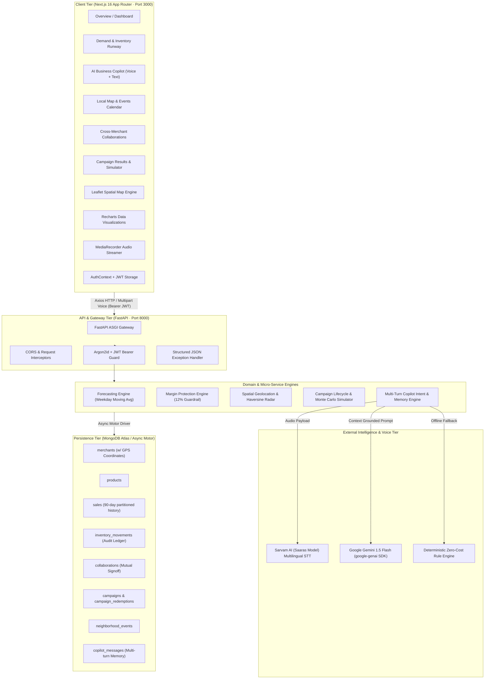
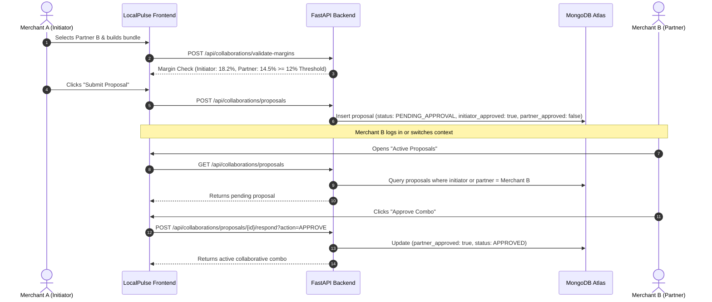

# LocalPulse AI — Hyper-Local Merchant Growth Platform

> **Hackathon Prototype** · **Paytm Build for India AI Hackathon** · *Merchant Growth AI Track*

LocalPulse AI is a production-grade, hyper-local demand forecasting and collaborative growth engine architected specifically for Indian MSMEs — kirana stores, neighbourhood cafes, organic produce marts, and retail shops. Built on modern distributed system principles, it pairs deterministic weekday-aware demand forecasting, real-time stockout prevention, audited inventory replenishment, and margin-protected multi-merchant co-promotions with an **AI Business Copilot** (featuring multilingual voice input via Sarvam AI & reasoning via Google Gemini) and a **Spatial Proximity Radar & Community Demand Calendar**.

---

## Table of Contents

1. [High-Level System Design & Architecture](#1-high-level-system-design--architecture)
2. [Domain Architecture & Core Subsystems](#2-domain-architecture--core-subsystems)
3. [End-to-End Data Flow Architecture](#3-end-to-end-data-flow-architecture)
4. [Database & Spatial Schema Design](#4-database--spatial-schema-design)
5. [Complete API Specifications](#5-complete-api-specifications)
6. [Design System & UI Architecture (Dribbble Modern Redesign)](#6-design-system--ui-architecture)
7. [AI Business Copilot & Indic Voice Pipeline](#7-ai-business-copilot--indic-voice-pipeline)
8. [Project Directory Topology](#8-project-directory-topology)
9. [Local Setup & Production Cloud Deployment](#9-local-setup--production-cloud-deployment)
10. [Demo Merchants, Clustered Geolocation & Test Scenarios](#10-demo-merchants-clustered-geolocation--test-scenarios)
11. [System Verification & End-to-End Walkthroughs](#11-system-verification--end-to-end-walkthroughs)

---

## 1. High-Level System Design & Architecture



### Technology Stack & Design Decisions

| Layer | Technology | Architectural Rationale |
|:---|:---|:---|
| **Frontend Framework** | **Next.js 16 (App Router), React 19** | Zero-bundle server components, instant route prefetching, Turbopack builds. |
| **Styling & Theme** | **Tailwind CSS v4** | Dark charcoal (`#16181a`), neon lime (`#e0fd53`), warm putty canvas (`#edece4`), zero emojis. |
| **Spatial Mapping** | **Leaflet with Carto Voyager** | Client-side dynamic loading, custom `L.divIcon` HTML markers, zero external image 404 bugs. |
| **Data Visualization** | **Recharts** | Responsive SVG charts with custom high-contrast tooltips (`#16181a` backdrop with lime/white typography). |
| **Backend Framework** | **FastAPI (Python 3.12)** | Asynchronous non-blocking concurrency, automatic OpenAPI schemas, native Pydantic v2 validation. |
| **Security & Auth** | **PyJWT (HS256) & Argon2id** | Cryptographically hardened password hashing via `argon2-cffi`, tenant-isolated tokens. |
| **Database** | **MongoDB Atlas + Motor** | Non-blocking async queries, schema flexibility for products and geo-spatial coordinates. |
| **Voice Processing** | **Sarvam AI (Saaras Model)** | High-accuracy Speech-to-Text across 10+ Indic languages (Hindi, Tamil, Telugu, Kannada, Bengali, etc.) and Indian English. |
| **LLM Reasoning** | **Google Gemini 1.5 Flash** | Sub-second generative explanations grounded strictly in store catalog and historical sales. |

---

## 2. Domain Architecture & Core Subsystems

### A. Weekday-Aware Demand Forecasting Engine
*File: `backend/app/services/forecasting.py`*
- **Algorithmic Strategy:** Stratified historical moving averages that distinguish weekend surges (Saturday/Sunday multiplier of 1.4x) from standard weekday trading baselines.
- **Stockout Runway Formulation:**
  $$\text{Daily Burn Rate} = \frac{\sum_{i=1}^{7} \text{Projected Units}_i}{7}$$
  $$\text{Runway Days} = \frac{\text{Current Stock}}{\text{Daily Burn Rate}}$$
- **Outputs:** 7-day projected unit volumes, expected daily store receipts, runway days remaining, stockout risk severity (`HIGH`, `MEDIUM`, `HEALTHY`), and algorithmic replenishment batch sizes.

### B. Deterministic Margin Protection Engine
*File: `backend/app/services/collaboration.py`*
- **The 12% Invariant:** Local retailers frequently suffer from discount-driven margin cannibalization. LocalPulse strictly enforces that **no multi-merchant bundle can be submitted if either merchant's post-discount margin drops below 12%**.
  $$\text{Discounted Selling Price} = \text{Original Selling Price} \times (1 - \text{Discount Rate})$$
  $$\text{Gross Margin \%} = \frac{\text{Discounted Selling Price} - \text{Cost Price}}{\text{Discounted Selling Price}} \times 100$$
- **Pre-Flight Validation:** If an initiator attempts to discount an item too aggressively, the real-time validator rejects the bundle and reports the exact economic shortfall before submission.

### C. Spatial Proximity Radar & Community Calendar
*Files: `backend/app/api/routes/neighborhood.py`, `frontend/src/components/map/NeighborhoodMap.js`*
- **Haversine Geodesic Distance:**
  $$d = 2R \arcsin\left(\sqrt{\sin^2\left(\frac{\Delta\phi}{2}\right) + \cos(\phi_1)\cos(\phi_2)\sin^2\left(\frac{\Delta\lambda}{2}\right)}\right)$$
  Calculates exact walking distances in meters between neighbouring shops in the Indiranagar cluster.
- **Retail Demand Catalysts:** Community festivals (Diwali), payroll credit weekends, farmers markets, and cricket screenings are mapped with coordinate pins and category demand multipliers (e.g. Traditional Sweets +160%, Grains +130%).

### D. Indic Voice-to-Text & Grounded Copilot
*Files: `backend/app/services/sarvam_voice.py`, `backend/app/services/copilot.py`*
- **Speech Streaming:** Captures microphone streams, encodes into standard 16kHz WAV buffers, and transcribes via Sarvam AI's REST endpoint across 10+ Indic languages.
- **Persistent Chat Memory & Contextual Pronoun Resolution:** Conversations are stored in `copilot_messages` with session isolation per merchant. Multi-turn reasoning resolves ambiguous pronouns ("it", "this product", "restock that") to recently discussed catalog items.
- **Audited Confirmation Pattern:** AI suggests operational actions (e.g., restocking 50 units or launching a 10% promo), but **never performs mutations without explicit user sign-off**. The frontend renders a structured draft proposal card requiring a physical click on **Confirm & Apply**.

### E. 3-Tier Dynamic Catalog Pricing Engine
*Files: `backend/app/services/campaign.py`, `backend/app/services/forecasting.py`, `backend/app/schemas/copilot.py`*
- **3-Tier Price Invariant:** Every catalog product tracks three distinct economic figures:
  1. `cost_price`: Wholesaler inventory acquisition cost.
  2. `selling_price`: Baseline retail list price / default MRP.
  3. `effective_selling_price`: Active transactional selling price consumed by POS and customer checkout.
- **Automated Lifecycle Synchronization:**
  - **Campaign Launch (`POST /api/campaigns`):** Automatically calculates and commits discounted `effective_selling_price` across all targeted catalog items:
    $$\text{effective\_selling\_price} = \text{round}\left(\text{selling\_price} \times \left(1 - \frac{\text{discount\_pct}}{100}\right), 2\right)$$
  - **Campaign Completion:** When a campaign concludes or is terminated, `effective_selling_price` automatically reverts to baseline `selling_price`.
- **System-Wide Grounding:** Daily revenue projections, 7-day demand forecasting, historical margin analysis, and AI Copilot reasoning strictly consume `effective_selling_price`.

### F. Tri-Category Prioritized Operational Actions (Overview Engine)
*File: `backend/app/api/routes/dashboard.py`*
- **Algorithmic Prioritization:** Rather than displaying generic or unranked recommendations, the executive overview surfaces the single highest-priority operational decision across three distinct categories:
  1. **Most Urgent Restock:** Identified by lowest runway days (< 5 days) and highest daily sales velocity.
  2. **Top Recommended Discount:** Highest inventory holding with low turnover to free up idle working capital.
  3. **Targeted Buffer Discount:** Lowest stock item paired with the minimum required discount percentage to clear remaining buffer before expiration without sacrificing margins.

---

## 3. End-to-End Data Flow Architecture

### Collaboration Proposal & Mutual Approval Lifecycle



---

## 4. Database & Spatial Schema Design

All documents reside in the **`localpulse`** MongoDB database.

### `merchants` Collection (with Spatial Coordinates)
```json
{
  "_id": "ObjectId(...)",
  "merchant_id": "merchant-001",
  "business_name": "Sharma Kirana & General Store",
  "owner_name": "Ramesh Sharma",
  "email": "sharma.kirana@localpulse.demo",
  "password_hash": "$argon2id$v=19$m=65536,t=3,p=4$...",
  "category": "Grocery & Daily Essentials",
  "address": "Shop 14, 12th Main Road, HAL 2nd Stage, Indiranagar, Bengaluru",
  "phone": "+91 98450 12345",
  "latitude": 12.9702,
  "longitude": 77.6428,
  "coordinates": {
    "lat": 12.9702,
    "lng": 77.6428
  },
  "created_at": "2026-07-28T00:00:00Z",
  "is_synthetic": true
}
```

### `neighborhood_events` Collection
```json
{
  "_id": "ObjectId(...)",
  "event_id": "event-001-diwali",
  "title": "Diwali Festival Shopping & Gifting Rush",
  "description": "Peak festive season shopping across Indiranagar 100ft & CMH Road.",
  "start_date": "2026-11-01",
  "end_date": "2026-11-05",
  "location_name": "Indiranagar 100ft & CMH Rd Retail Corridor",
  "coordinates": { "lat": 12.9730, "lng": 77.6410 },
  "category_impacts": [
    {
      "category": "Traditional Sweets",
      "multiplier": 2.6,
      "projected_demand_change_pct": 160,
      "highlight_products": ["Kaju Katli", "Spicy Mixture"]
    }
  ],
  "recommended_action": "Maintain buffer inventory of 50+ packs of Chakki Atta and sweet gift hampers.",
  "severity": "HIGH"
}
```

### `products` Collection (3-Tier Pricing Model)
```json
{
  "_id": "ObjectId(...)",
  "product_id": "prod-001-milk",
  "merchant_id": "merchant-001",
  "name": "Amul Taaza Homogenised Toned Milk 1L",
  "category": "Dairy",
  "cost_price": 66.0,
  "selling_price": 74.0,
  "effective_selling_price": 74.0, // Discounted during active campaigns; restored to selling_price on campaign end
  "current_stock": 9,
  "reorder_threshold": 25,
  "unit": "cartons",
  "base_demand": 22.0
}
```

### `sales` & `inventory_movements` Ledger
```json
// sales
{
  "sale_id": "sale-001-20261025-milk",
  "merchant_id": "merchant-001",
  "product_id": "prod-001-milk",
  "date": "2026-10-25",
  "units_sold": 26,
  "revenue": 1924.0,
  "is_synthetic": true
}

// inventory_movements (Audit Record)
{
  "movement_id": "mov-e4a83b12",
  "merchant_id": "merchant-001",
  "product_id": "prod-001-milk",
  "product_name": "Amul Taaza Homogenised Toned Milk 1L",
  "adjustment_type": "RESTOCK",
  "quantity_change": 50,
  "stock_before": 9,
  "stock_after": 59,
  "notes": "Audited restock via AI Copilot",
  "created_at": "2026-10-31T05:22:10Z"
}
```

### `copilot_messages` Collection (Persistent Multi-Turn Memory)
```json
{
  "_id": "ObjectId(...)",
  "merchant_id": "merchant-001",
  "role": "assistant",
  "content": "Amul Taaza Milk has 9 cartons left (1.3 days runway). Would you like to restock 50 cartons?",
  "pending_action": {
    "action_type": "RESTOCK_INVENTORY",
    "params": {
      "product_id": "prod-001-milk",
      "quantity": 50
    },
    "description": "Restock 50 cartons of Amul Taaza Homogenised Toned Milk 1L"
  },
  "action_confirmed": true,
  "created_at": "2026-10-31T06:14:22Z"
}
```

---

## 5. Complete API Specifications

Interactive Swagger UI documentation is served live at: **`http://localhost:8000/docs`**

### Authentication & Tenant Context (`/api/auth`)
- `POST /api/auth/login`: Authenticate via email/password; returns bearer JWT and profile.
- `POST /api/auth/signup`: Onboard a new merchant shop (automatically assigned local coordinates).
- `GET /api/auth/me`: Retrieve currently authenticated merchant profile with coordinates.
- `GET /api/auth/demo-merchants`: Fetch all seeded synthetic merchants for instant review.
- `POST /api/auth/switch-demo`: Instantly swap JWT context to another merchant account.

### Local Map & Neighborhood Spatial Radar (`/api/neighborhood`)
- `GET /api/neighborhood/merchants`: Returns all neighboring stores with calculated Haversine distance, street address, and category synergy scores.
- `GET /api/neighborhood/events`: Fetches scheduled community footfall events with geographic coordinates and category demand multipliers.
- `GET /api/neighborhood/summary`: Spatial cluster summary (count of nearby partners, closest store distance, active event count).

### AI Copilot & Voice (`/api/copilot`)
- `POST /api/copilot/chat`: Dual-format request body (`message` or `query`) with multi-turn MongoDB memory. Returns grounded reply, evidence tags, and pending draft mutation card.
- `POST /api/copilot/voice-to-text`: Multipart audio upload converted to text via Sarvam AI (supports Hindi, Tamil, Telugu, Kannada, Bengali, Marathi, and English).
- `POST /api/copilot/confirm-action`: Explicit execution of proposed draft action (`RESTOCK_INVENTORY`, `CREATE_CAMPAIGN`, `ADD_PRODUCT`).
- `GET /api/copilot/history`: Retrieves isolated conversation log for the active merchant.
- `DELETE /api/copilot/history`: Resets conversational memory for a fresh session.

### Multi-Merchant Collaborations (`/api/collaborations`)
- `GET /api/collaborations/discover`: Discovers local cross-promotion partners with calculated complementary pairings.
- `POST /api/collaborations/validate-margins`: Deterministic math checking the 12% safety threshold for both shops.
- `POST /api/collaborations/proposals`: Submits a new cross-store bundle proposal.
- `POST /api/collaborations/proposals/{id}/respond?action=APPROVE`: Records partner sign-off and activates the combo.

### System Reset (`/api/seed/reset`)
- `POST /api/seed/reset`: Re-seeds all 6 Indiranagar merchants, sets exact shop coordinates, resets inventory to baseline, regenerates 90-day sales, and restores 7 retail events.

---

## 6. Design System & UI Architecture

Inspired by premium dashboard aesthetics (Dribbble management dashboard concepts), LocalPulse adheres to a strict design system:

- **Curated Colour Palette:**
  - Background: Warm putty stone canvas (`#edece4`)
  - Primary Panels & Floating Sidebar: Deep charcoal (`#16181a` / `#151719`)
  - Highlighting & Accents: Electric lime (`#e0fd53`)
  - Alert & Safety States: Terracotta (`#c25e4e`), Amber (`#8c5208`), Mineral Sage (`#2d5a27`)
- **Zero Emojis:** Replaced entirely with crisp vector iconography via `lucide-react`.
- **Display Typography:** High-contrast tracking, bold headers, and monospace coordinates.
- **Fixed-Frame Full-Height Copilot:** Eliminates vertical page gaps, matching the bottom radius of the floating sidebar.

---

## 7. AI Business Copilot & Indic Voice Pipeline

```mermaid
graph LR
    A["Merchant Speaks in Indian Language"] -->|"WAV 16kHz Stream"| B["Sarvam AI (Saaras Model)"]
    B -->|"Transcribed Text"| C["Copilot Engine (/api/copilot/chat)"]
    C -->|"Context Injection: Live Catalog + Sales History"| D["Google Gemini 1.5 Flash"]
    D -->|"Structured Action Proposal"| E["Draft Mutation Card (Pending Confirmation)"]
    E -->|"Physical User Confirmation"| F["Audited MongoDB Write (Stock/Campaign)"]
```



---

## 8. Project Directory Topology

```
LocalPulse/
├── README.md                           # System Design & Architecture Guide
├── render.yaml                         # 1-Click Render Cloud Deployment Blueprint
├── .gitignore
│
├── backend/
│   ├── .env                            # Active environment configuration
│   ├── .env.example                    # Sample configuration template
│   ├── requirements.txt                # Python dependencies
│   ├── Procfile                        # Render / Railway process definition
│   ├── run.py                          # Cloud ASGI entrypoint with dynamic $PORT binding
│   ├── runtime.txt                     # Pinned Python runtime (3.12.1)
│   └── app/
│       ├── main.py                     # ASGI root, lifespan, CORS, route registry
│       ├── seed.py                     # Synthetic data seeder (merchants, events, sales)
│       ├── core/
│       │   ├── config.py               # Pydantic BaseSettings
│       │   └── security.py             # JWT encode/decode & Argon2id hashing
│       ├── db/
│       │   └── session.py              # Motor client & MongoDB connection pool
│       ├── api/
│       │   ├── dependencies.py         # JWT bearer auth dependency
│       │   └── routes/
│       │       ├── auth.py             # Authentication & demo switching
│       │       ├── dashboard.py        # Executive summary KPIs & trends
│       │       ├── demand.py           # Forecasts & 30-day sales runway
│       │       ├── products.py         # Catalog CRUD & stock movements
│       │       ├── copilot.py          # AI Copilot & Sarvam voice STT
│       │       ├── neighborhood.py     # Spatial map radar & community events
│       │       ├── collaborations.py   # Cross-store bundles & margin guards
│       │       └── campaigns.py        # Marketing campaigns & redemption sim
│       ├── services/
│       │   ├── forecasting.py          # Weekday-stratified moving average
│       │   ├── collaboration.py        # Margin arithmetic & partner discovery
│       │   ├── copilot.py              # Copilot coordinator & memory
│       │   ├── copilot_executor.py     # Tool execution & mutation drafts
│       │   ├── sarvam_voice.py         # Sarvam AI Indic STT client
│       │   └── gemini.py               # Google GenAI SDK interface
│       └── schemas/                    # Pydantic v2 schemas
│           ├── auth.py
│           ├── copilot.py
│           ├── neighborhood.py
│           └── collaboration.py
│
└── frontend/
    ├── package.json
    ├── .env.local                      # NEXT_PUBLIC_API_URL=http://localhost:8000
    └── src/
        ├── app/
        │   ├── layout.js               # Global HTML root layout
        │   ├── globals.css             # Tailwind v4 theme & token variables
        │   ├── login/page.js           # 1-click merchant auth portal
        │   ├── dashboard/page.js       # Overview with high-contrast Recharts
        │   ├── demand/page.js          # Demand runway & audited stock modals
        │   ├── copilot/page.js         # Fixed-frame AI copilot with Sarvam voice
        │   ├── neighborhood/page.js    # Interactive map, merchant radar & calendar
        │   ├── collaborations/page.js  # Multi-merchant proposal workflow
        │   └── campaigns/page.js       # Campaign simulator & ROMS tracking
        ├── components/
        │   ├── layout/
        │   │   ├── AppLayout.js        # Responsive wrapper with fullHeight support
        │   │   ├── Header.js           # Context title, demo switcher & reset modal
        │   │   └── Sidebar.js          # Floating charcoal navigation panel
        │   ├── map/
        │   │   └── NeighborhoodMap.js  # Dynamic Leaflet spatial map
        │   ├── calendar/
        │   │   └── NeighborhoodCalendar.js # Interactive retail demand calendar
        │   └── ui/
        │       ├── Modal.js
        │       ├── Badge.js
        │       └── StatCard.js
        ├── context/AuthContext.js      # Global merchant auth provider
        └── lib/api.js                  # Axios client with bearer interceptor
```

---

## 9. Local Setup & Production Cloud Deployment

### A. Local Development Environment

#### Prerequisites
- **Node.js**: v18.0 or higher
- **Python**: v3.10 to v3.12 (Python 3.12 recommended)
- **MongoDB**: MongoDB Atlas cluster or local instance (system automatically falls back to in-memory `mongomock-motor` if offline)

#### Step 1: Backend Setup
```powershell
cd backend

# Create and activate Python virtual environment
python -m venv .venv
.\.venv\Scripts\Activate.ps1       # Windows PowerShell
# source .venv/bin/activate        # macOS / Linux

# Install dependencies
pip install -r requirements.txt

# Configure environment variables
Copy-Item .env.example .env
```

Ensure your `backend/.env` contains:
```env
MONGODB_URI=mongodb+srv://<username>:<password>@cluster0.abcde.mongodb.net/?retryWrites=true&w=majority
DATABASE_NAME=localpulse
JWT_SECRET=localpulse-super-secret-jwt-key-2026-paytm-ai-hackathon
FRONTEND_URL=http://localhost:3000
ALLOWED_ORIGINS=http://localhost:3000,http://127.0.0.1:3000

# Voice & AI (Optional: deterministic rule engine works offline without keys)
SARVAM_API_KEY=your_sarvam_api_key
SARVAM_STT_MODEL=saaras:v4
LLM_API_KEY=your_gemini_api_key
LLM_PROVIDER=gemini
LLM_MODEL=gemini-2.5-flash
```

Launch the backend ASGI server:
```powershell
uvicorn app.main:app --host 127.0.0.1 --port 8000 --reload
```

#### Step 2: Frontend Setup
```powershell
cd ../frontend

# Install node dependencies
npm install

# Start Next.js development server
npm run dev
```

Open **`http://localhost:3000`** in your browser.

---

### B. Production Deployment: Render (Backend) & Vercel (Frontend)

LocalPulse is pre-configured for zero-friction cloud deployment pairing **FastAPI on Render** with **Next.js on Vercel**.

#### 1. Deploy Backend on [Render](https://render.com) (Web Service)
1. In Render Dashboard, click **New +** $\rightarrow$ **Web Service** and connect your GitHub repository.
2. Configure service parameters:
   - **Name**: `localpulse-backend`
   - **Root Directory**: `backend`
   - **Environment**: `Python 3`
   - **Build Command**: `pip install -r requirements.txt`
   - **Start Command**: `uvicorn app.main:app --host 0.0.0.0 --port $PORT` *(or `python run.py`)*
   - **Health Check Path**: `/health`
3. In **Environment Variables**, configure:
   | Key | Value / Guidance |
   |:---|:---|
   | `MONGODB_URI` | Your MongoDB Atlas connection URI (`mongodb+srv://...`) |
   | `DATABASE_NAME` | `localpulse` |
   | `JWT_SECRET` | 32+ character random string for cryptographically signing JWTs |
   | `FRONTEND_URL` | Your Vercel frontend URL (e.g. `https://localpulse-frontend.vercel.app`) |
   | `LLM_PROVIDER` | `gemini` |
   | `LLM_MODEL` | `gemini-2.5-flash` |
   | `LLM_API_KEY` | Your Google Gemini API key (from [AI Studio](https://aistudio.google.com/app/apikey)) |
   | `SARVAM_API_KEY` | Your Sarvam AI key (from [Sarvam Dashboard](https://dashboard.sarvam.ai)) |
   | `SARVAM_STT_MODEL` | `saaras:v4` |
4. Click **Create Web Service**. Render provisions the environment, runs `seed.py` on startup to initialize demo data, and issues a live HTTPS endpoint (e.g. `https://localpulse-backend.onrender.com`).

*(Optional: If deploying via Render Blueprints, the included root [`render.yaml`](render.yaml) automatically provisions this service with 1 click).*

#### 2. Deploy Frontend on [Vercel](https://vercel.com)
1. In Vercel Dashboard, click **Add New...** $\rightarrow$ **Project** and import your GitHub repository.
2. In **Project Settings**:
   - **Framework Preset**: `Next.js`
   - **Root Directory**: Click `Edit` and select `frontend`
   - **Build Command**: `npm run build` *(default)*
   - **Output Directory**: `.next` *(default)*
3. In **Environment Variables**, define:
   - `NEXT_PUBLIC_API_URL`: Your deployed Render backend URL (e.g. `https://localpulse-backend.onrender.com`)
   *(Note: The client automatically normalizes trailing slashes and handles both `...onrender.com` and `...onrender.com/api` transparently).*
4. Click **Deploy**. Vercel compiles the production bundle and issues your live URL.
5. In your Render Dashboard, ensure `FRONTEND_URL` is set to your Vercel domain to permit cross-origin credentials. (The backend CORS engine also natively whitelists all `*.vercel.app` preview branches).

---

## 10. Demo Merchants, Clustered Geolocation & Test Scenarios

All accounts share the default password: **`password123`**

| Merchant Account | Category | Clustered Coordinates | Test Scenario |
|:---|:---|:---|:---|
| **Sharma Kirana & General Store** | Grocery & Essentials | `12.9702° N, 77.6428° E` | High-turnover milk stockout risk, active discount campaign. |
| **Modern Threads & Apparel** | Fashion & Textiles | `12.9718° N, 77.6432° E` | **200m away**; high gross margins, payday weekend surge. |
| **Sanjeevani Ayurvedic Wellness** | Health & Wellness | `12.9689° N, 77.6395° E` | **400m away**; immunity wellness pack co-promotions. |
| **Chai Point & Baker's Corner** | Cafe & Bakery | `12.9734° N, 77.6406° E` | **420m away**; morning breakfast bundle collaboration partner. |
| **Anand Sweets & Savories** | Traditional Sweets | `12.9751° N, 77.6465° E` | **650m away**; Diwali gifting rush festive hamper bundles. |
| **Green Valley Organic Produce** | Fresh Produce | `12.9782° N, 77.6385° E` | **950m away**; tight perishable shelf-life, weekend farmers market. |

---

## 11. System Verification & End-to-End Walkthroughs

### Workflow 1: Inspect Spatial Proximity & Community Events
1. In the sidebar, navigate to **Local Map & Events** (`/neighborhood`).
2. Observe your store highlighted with a pulsing radar marker at `12.9702° N, 77.6428° E`.
3. Inspect adjacent merchant markers showing real walking distances (`200m`, `420m`, etc.).
4. Click on any event in the **Retail Demand Calendar** (e.g. *Diwali Festival Shopping*) to highlight its neighborhood location and view recommended inventory preparations.

### Workflow 2: Voice-Driven AI Inventory Audit
1. Navigate to **AI Business Copilot** (`/copilot`).
2. Click the **Mic** button and speak in Hindi, English, Tamil, or Telugu: *"Which items are running low on stock?"*
3. The audio is transcribed via Sarvam AI and processed by Gemini/Rule engine.
4. Review the grounded evidence showing Amul Taaza Milk below threshold.
5. Click **Confirm & Apply** on the proposed Restock action to commit an audited write to MongoDB.

### Workflow 3: Cross-Merchant Bundle with Margin Guard
1. Navigate to **Collaborations** (`/collaborations`).
2. Under **Nearby Store Partners**, click **Propose Bundle** for *Chai Point & Baker's Corner*.
3. Test setting an aggressive 30% discount — observe the live 12% safety check turn red and block submission.
4. Set safe 10% discounts on both items and click **Submit Proposal**.
5. Use the header **Demo Merchant Switcher** to switch to *Chai Point & Baker's Corner*.
6. In **Active Proposals**, click **Approve Combo** to activate the cross-store collaboration.

### Workflow 4: Global Environment Reset
1. Open the header **Merchant Switcher** or the top button on the **Local Map & Events** page.
2. Click **Reset Entire Database**.
3. Confirm the modal to re-seed all 6 merchants, restore exact GPS coordinates, refresh 90-day sales records, and regenerate all 7 community demand events.

### Workflow 5: Dynamic Campaign & 3-Tier Pricing Lifecycle
1. Navigate to **Campaign Results** (`/campaigns`).
2. Launch a new discount campaign (e.g. 10% *Special Discount* on select grocery essentials).
3. Check the **Demand & Inventory Runway** (`/demand`): observe the active `effective_selling_price` reflects the discounted price while `cost_price` and default `selling_price` remain safely preserved.
4. Verify that forecasted store receipts and Copilot recommendations dynamically evaluate the discounted price.
5. Terminate or complete the campaign — observe the product catalog automatically restore `effective_selling_price` back to the default `selling_price`.

---

## License

Prototype developed for the **Paytm Build for India AI Hackathon 2026** under the *Merchant Growth AI* track.
