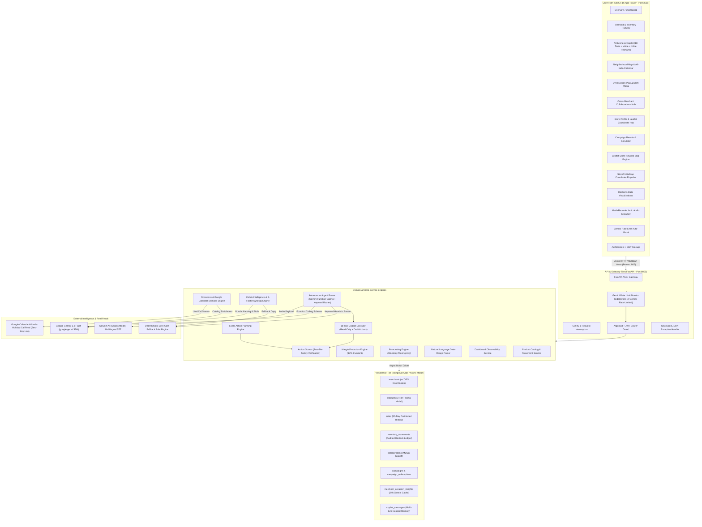
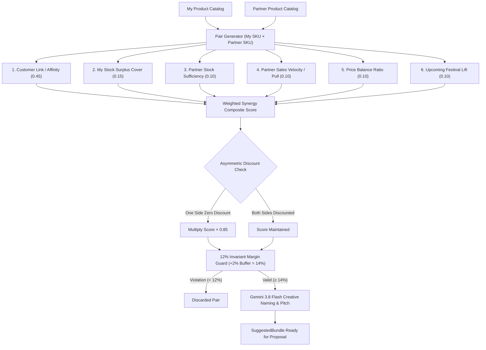
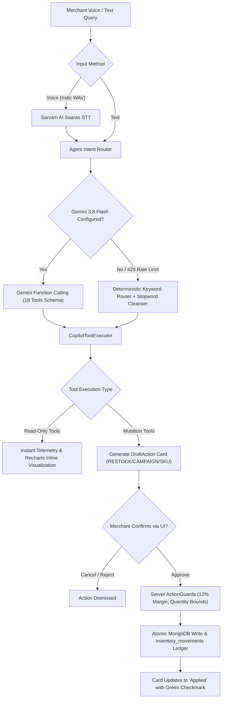
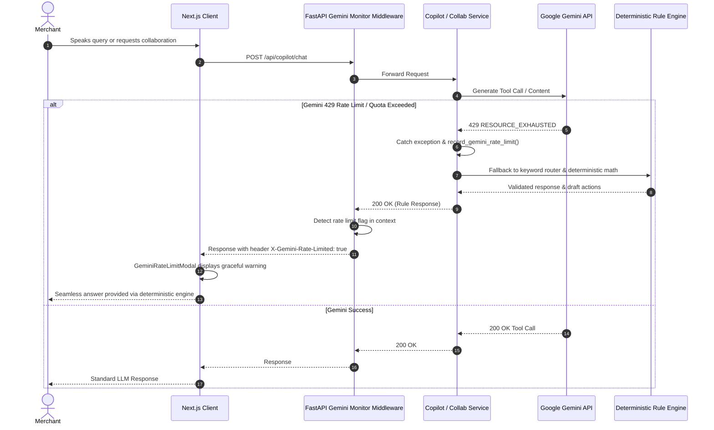

# LocalPulse AI — Hyperlocal MSME Demand Intelligence, Copilot & Growth Engine

> **Hackathon Prototype** · **Paytm Build for India AI Hackathon** · *Merchant Growth AI Track*

LocalPulse AI is a production-grade, hyper-local demand forecasting and collaborative growth engine architected specifically for Indian MSMEs — kirana stores, neighbourhood cafes, organic produce marts, and retail shops. Built on modern distributed system principles, it pairs deterministic weekday-aware demand forecasting, real-time stockout prevention, audited inventory replenishment, and margin-protected multi-merchant co-promotions with an **Autonomous 18-Tool AI Business Copilot** (featuring multilingual voice input via Sarvam AI & reasoning via Google Gemini 3.8 Flash), a **Live All-India Occasion Demand Engine** (powered by Google Calendar's continuous national holiday feed), a **6-Factor Collaboration Synergy Engine** (with a strict 12% profit margin invariant), and a **Storefront Spatial Radar & Leaflet Geolocation Hub**.

---

## Table of Contents

1. [High-Level System Design & Architecture](#1-high-level-system-design--architecture)
2. [Deep Dive: Logic for Map Suggestions & Spatial Radar](#2-deep-dive-logic-for-map-suggestions--spatial-radar)
3. [Deep Dive: Logic for Collaboration Suggestions & 6-Factor Synergy](#3-deep-dive-logic-for-collaboration-suggestions--6-factor-synergy)
4. [Deep Dive: Logic for AI Copilot Agent & 18 Autonomous Tools](#4-deep-dive-logic-for-ai-copilot-agent--18-autonomous-tools)
5. [Weekday Demand Modeling & 3-Tier Catalog Pricing](#5-weekday-demand-modeling--3-tier-catalog-pricing)
6. [Resilience, Rate-Limit Monitoring & Offline Safety Shield](#6-resilience-rate-limit-monitoring--offline-safety-shield)
7. [Database & Spatial Schema Design](#7-database--spatial-schema-design)
8. [Complete API Specifications](#8-complete-api-specifications)
9. [Project Directory Topology](#9-project-directory-topology)
10. [Local Setup & Production Cloud Deployment](#10-local-setup--production-cloud-deployment)
11. [Demo Merchants, Clustered Geolocation & Walkthroughs](#11-demo-merchants-clustered-geolocation--walkthroughs)

---

## 1. High-Level System Design & Architecture



### Technology Stack & Architectural Decisions

| Layer | Technology | Architectural Rationale |
|:---|:---|:---|
| **Frontend Framework** | **Next.js 16 (App Router), React 19** | Zero-bundle server components, instant route prefetching, Turbopack builds (all routes statically prerendered with 0 errors). |
| **Styling & Theme** | **Tailwind CSS v4** | Utility-first responsive CSS styling with modular design tokens. |
| **Spatial Mapping** | **Leaflet with OpenStreetMap** | Dynamic client-side tile mapping (`NeighborhoodMap.js` & `StoreProfileMap.js`) without Google Maps API key fees. |
| **Data Visualization** | **Recharts** | High-contrast SVG charts with custom `#16181a` tooltips, plus inline interactive charts directly inside Copilot chat bubbles. |
| **Backend Framework** | **FastAPI (Python 3.12)** | Asynchronous non-blocking concurrency, automatic OpenAPI 3.1 schemas, native Pydantic v2 validation. |
| **Security & Auth** | **PyJWT (HS256) & Argon2id** | Cryptographically hardened password hashing via `argon2-cffi`, tenant-isolated tokens. |
| **Database** | **MongoDB Atlas + Motor** | Non-blocking async queries, schema flexibility for products, sales, and audited movement ledgers. |
| **Voice Processing** | **Sarvam AI (Saaras Model)** | High-accuracy Speech-to-Text across 10+ Indic languages (Hindi, Tamil, Telugu, Kannada, Bengali, etc.) and Indian English. |
| **LLM Reasoning** | **Google Gemini 3.8 Flash** | Fast, high-accuracy generative reasoning grounded strictly in store catalog and historical sales. |
| **Offline Safety Shield** | **Deterministic Fallback Engine** | Dual-engine fallback: if external LLMs experience rate limits (429) or internet drops, rule-based algorithms execute 100% offline. |
| **Calendar & Festivals** | **Google Calendar Live iCal Feed** | Official All-India holidays and festivals (`en.indian#holiday@group.v.calendar.google.com`), 100% free with zero API key dependencies. |

---

## 2. Deep Dive: Logic for Map Suggestions & Spatial Radar

The **Spatial Radar & Neighborhood Map** subsystem provides hyper-local visibility for merchants, connecting neighboring stores into a collaborative commercial network.

### A. Haversine Distance Calculation

All inter-store distances are computed on the sphere using the Haversine trigonometric formulation:

$$\Delta \text{lat} = \text{radians}(\text{lat}_2 - \text{lat}_1), \quad \Delta \text{lon} = \text{radians}(\text{lon}_2 - \text{lon}_1)$$

$$a = \sin^2\left(\frac{\Delta \text{lat}}{2}\right) + \cos(\text{radians}(\text{lat}_1))\cos(\text{radians}(\text{lat}_2))\sin^2\left(\frac{\Delta \text{lon}}{2}\right)$$

$$c = 2 \cdot \text{atan2}\left(\sqrt{a}, \sqrt{1-a}\right)$$

$$d_{\text{km}} = R \cdot c \quad \text{where } R = 6371.0 \text{ km}$$

$$d_{\text{meters}} = \text{int}(d_{\text{km}} \times 1000)$$

- **Resolution**: Returns distances in both whole meters (for walking distance under 1 km) and kilometers (with 2 decimal precision).
- **Proximity Filtering**: Supports radius filters (e.g. `within 0.5 km`, `1.0 km`, `2.0 km`) via both the REST API and the Copilot agent tool `get_nearby_merchants`.

### B. Storefront Geolocation & Automatic Cluster Jittering

- **Bengaluru Baseline Cluster**: Centered at coordinates `12.920737° N, 77.668710° E` (Bellandur / Indiranagar retail cluster).
- **Signup Geolocation Fallback**: When a new merchant registers without providing exact coordinates, the backend (`auth.py`) automatically places the store within a realistic walking radius of the neighborhood cluster using bounded Gaussian jitter:
  $$\text{lat} = 12.920737 + \text{uniform}(-0.0035, +0.0035)$$
  $$\text{lng} = 77.668710 + \text{uniform}(-0.0035, +0.0035)$$
  This ensures newly onboarded stores are instantly positioned within 100m to 450m of partner stores.
- **Store Profile Map (`/profile`)**: Merchants can interactively view and update their storefront location via `StoreProfileMap.js`. They can click or drag the map pin to update coordinates or click **"Detect Current GPS Location"** to use the browser's HTML5 Geolocation API (`navigator.geolocation.getCurrentPosition`).

### C. Unified Collaboration Intelligence Integration on the Map

The map is not a passive directory — it directly embeds the **6-Factor Collaboration Intelligence**:
- The `/api/neighborhood/merchants` endpoint invokes `load_suggestions(db, merchant, use_ai="cache")` for every nearby store.
- Each marker and merchant card displays:
  - **Synergy Score**: e.g., `88% Synergy`
  - **Synergy Theme**: e.g., `"Chai & Snack Combo"`, `"Breakfast Basket"`
  - **Synergy Pitch**: Real business rationale (e.g., *"Customers buying tea often pick up something to eat with it. Bundle with Krishna Bakery's Rusks."*)
  - **Top Catalog SKUs**: The top 4 products available at the neighbor shop.
  - **1-Click Propose Bundle Button**: Clicking **"Propose Bundle"** opens the `ProposalModal` directly on the map page, pre-populated with pre-validated 14% safe margins. The merchant never has to leave the map view to submit a collaboration proposal.

### D. Live All-India Occasions Feed & Action Plans

- **Continuous iCal Sync**: Reads the Google Calendar All-India holiday iCal feed, parsing start dates, end dates, severity, and event titles.
- **Proximity & Category Demand Multipliers**: Computes demand multipliers for categories relevant to the merchant's business (e.g., `Traditional Sweets: 2.8x`, `Dairy: 1.8x`, `Grocery: 1.5x` during Diwali).
- **Paytm Soundbox Audio Guidance**: Generates practical audio checkout guidance (e.g., *"Set Paytm Soundbox to maximum volume for peak evening rush"*).
- **Interactive Action Plan Modal**: Clicking **"Action Plan"** on any calendar event executes `/api/neighborhood/events/action-plan`, evaluating 120 days of historical sales and instantly creating confirmable **Restock Draft Cards**, **Festival Offer Drafts**, and **Partner Combo Ideas**.

---

## 3. Deep Dive: Logic for Collaboration Suggestions & 6-Factor Synergy

The Collaboration Intelligence engine (`collab_intelligence.py`) eliminates blind guessing by evaluating every possible pairing of $(P_{\text{my}}, P_{\text{partner}})$ against 6 empirical commerce signals.



### A. The 6-Factor Scoring Formula

$$\text{Composite Score} = 0.45 S_{\text{affinity}} + 0.15 S_{\text{surplus}} + 0.10 S_{\text{partner\_stock}} + 0.10 S_{\text{partner\_pull}} + 0.10 S_{\text{price}} + 0.10 S_{\text{festival}}$$

#### 1. Customer Link / Affinity ($w = 0.45$)
Products are classified into semantic commerce facets based on category and title keywords:
`tea`, `bakery`, `dairy`, `staple`, `oil`, `vegetable`, `fruit`, `sweets`, `wellness`, `apparel`.

A predefined empirical affinity table models real consumer basket co-occurrence:
- `tea` $\times$ `bakery` $\to 1.00$ (*"Chai & Snack Combo"*)
- `dairy` $\times$ `bakery` $\to 0.95$ (*"Breakfast Basket"*)
- `dairy` $\times$ `tea` $\to 0.90$ (*"Morning Chai Kit"*)
- `staple` $\times$ `oil` $\to 0.90$ (*"Kitchen Staples Pack"*)
- `tea` $\times$ `sweets` $\to 0.85$ (*"Chai-Time Namkeen Pack"*)
- `staple` $\times$ `vegetable` $\to 0.80$ (*"Daily Cooking Basket"*)
- `oil` $\times$ `vegetable` $\to 0.75$ (*"Fresh Cooking Basket"*)
- `fruit` $\times$ `wellness` $\to 0.75$ (*"Fresh & Wellness Pack"*)
- `tea` $\times$ `wellness` $\to 0.70$ (*"Immunity Tea Pack"*)
- `bakery` $\times$ `sweets` $\to 0.70$ (*"Celebration Treats Box"*)

*Rule*: Any pairing with affinity $< 0.60$ or sharing identical facets is immediately discarded.

#### 2. My Stock Surplus ($w = 0.15$)
Promotions should liquidate surplus stock, **never** accelerate a stockout:
- Let $v_A$ be the 14-day daily sales velocity of product $A$:
  $$v_A = \frac{\sum_{i=1}^{14} \text{units}_i}{14}$$
- Days of stock cover: $\text{cover}_A = \frac{\text{current\_stock}_A}{v_A}$
- Compared against the shop's median typical cover:
  $$\text{typical} = \text{median}(\{\text{cover}_p \mid p \in \text{Catalog}\})$$
- **Strict Stock Safety Gate**: An item is **strictly excluded** if:
  $$\frac{\text{current\_stock}}{\text{reorder\_threshold}} \le 1.0 \quad \text{OR} \quad \text{cover}_A < 0.6 \times \text{typical}$$
- Surplus score:
  $$S_{\text{surplus}} = \text{clamp}\left(\frac{\text{cover}_A / \text{typical} - 0.8}{1.2}, 0.0, 1.0\right)$$

#### 3. Partner Stock Sufficiency ($w = 0.10$)
$$S_{\text{partner\_stock}} = \begin{cases} 1.0 & \text{if } \frac{\text{current\_stock}_B}{\text{reorder\_threshold}_B} > 1.0 \\ 0.3 & \text{otherwise} \end{cases}$$

#### 4. Partner Pull / Footfall Velocity ($w = 0.10$)
Measures whether the partner's item sells fast enough to attract footfall:
$$S_{\text{partner\_pull}} = \frac{v_B}{\max_{p \in \text{Partner}} v_p}$$

#### 5. Price Balance Ratio ($w = 0.10$)
Bundling a ₹28 packet of biscuits with a ₹1,800 silk saree fails because customers do not purchase wildly mismatched price points together:
$$\text{balance} = \frac{\min(P_A, P_B)}{\max(P_A, P_B)}$$
$$S_{\text{price}} = \begin{cases} 0.0 & \text{if } \text{balance} < 0.08 \\ \sqrt{\text{balance}} & \text{otherwise} \end{cases}$$

#### 6. Festival Demand Boost ($w = 0.10$)
$$S_{\text{festival}} = \begin{cases} 1.0 & \text{if an upcoming festival (within 21 days) boosts both categories} \\ 0.0 & \text{otherwise} \end{cases}$$
When a festival lifts both items (e.g. Diwali lifting Traditional Sweets and Apparel), festival affinity combinations activate (`sweets + apparel` $\to 0.90$, `staple + oil` $\to 0.95$).

#### Asymmetric Discount Penalty
If one merchant provides a discount while the partner contributes 0%, the partnership is unfair and less likely to be signed off:
$$\text{Score} \leftarrow \text{Score} \times 0.85 \quad \text{if } d_A = 0 \text{ or } d_B = 0$$

### B. Deterministic 12% Margin Invariant (+2% Safety Buffer)

To protect MSMEs from loss-making co-promotions:
1. **Target Margin Floor**:
   $$\text{keep} = \frac{\text{MIN\_MARGIN\_PCT} + \text{MARGIN\_BUFFER\_PCT}}{100} = \frac{12\% + 2\%}{100} = 0.14$$
2. **Maximum Safe Discount ($d_{\max}$)**:
   $$d_{\max} = \max\left(0, \left\lfloor \left(1.0 - \frac{\text{cost\_price}}{(1.0 - \text{keep}) \times \text{selling\_price}}\right) \times 100 \right\rfloor\right)$$
3. **Target Side Discount**:
   $$d = \min(\text{TARGET\_SIDE\_DISCOUNT\_PCT}, d_{\max}) = \min(10.0\%, d_{\max})$$
   $$d = \begin{cases} d & \text{if } d \ge 3.0\% \\ 0.0 & \text{otherwise (not worth advertising)} \end{cases}$$
4. **Validation Check**:
   Both products are validated through `collaboration_service.validate_bundle_margins()`:
   $$\text{Margin}_A = \frac{P_{A,\text{discounted}} - C_A}{P_{A,\text{discounted}}} \ge 12.0\% \quad \text{AND} \quad \text{Margin}_B = \frac{P_{B,\text{discounted}} - C_B}{P_{B,\text{discounted}}} \ge 12.0\%$$
   If either margin violates 12%, the combo is rejected.

### C. Hybrid Architecture: Deterministic Math + LLM Copywriting

- **100% Deterministic Arithmetic**: Scores, discounts, prices, and viability checks are calculated strictly in Python code. The LLM has zero authority over numbers.
- **Gemini Creative Layer**: Gemini 3.8 Flash is passed the validated candidate pairs to select the most commercially appealing combo and write the bundle name and pitch.
- **Offline / Rate-Limit Resilience**: If Gemini is offline or rate limited, rule-based title and pitch templates generate high-quality proposals instantly without blocking the user.

---

## 4. Deep Dive: Logic for AI Copilot Agent & 18 Autonomous Tools

The **LocalPulse AI Copilot** is an autonomous operational assistant accessible via text and Indic voice. It executes read-only analytical queries instantly and converts store mutations into confirmable draft actions.



### A. The 18 Registered Agent Tools

The system declares 18 function-calling tools in `COPILOT_TOOLS`:

| # | Tool Name | Scope | Operational Capability |
|:---|:---|:---|:---|
| **1** | `get_catalog_products` | Read | Lists complete catalog with current stock levels, retail selling prices, cost prices, and categories. Supports optional category filtering. |
| **2** | `analyze_product_performance` | Read | Evaluates sales velocity, revenue, unit trends, and stock runway for a specific product over custom time periods (`today`, `yesterday`, `this week`, `last month`, custom days). |
| **3** | `get_restock_recommendations` | Read | Scans inventory for products below safety reorder thresholds with projected replenishment units. |
| **4** | `get_discount_recommendations` | Read | Identifies slow-moving or excess inventory and recommends margin-safe clearance discounts. |
| **5** | `adjust_inventory_stock` | Mutation | Generates confirmable mutation draft for `RESTOCK`, `DAMAGE_LOSS`, or `AUDIT_CORRECTION` with stock movements logging. |
| **6** | `add_catalog_product` | Mutation | Proposes adding a new SKU to the catalog with cost price, retail price, initial stock, and safety reorder threshold. |
| **7** | `create_promotional_campaign` | Mutation | Drafts promotional discount campaigns with budget, duration, and automatic `effective_selling_price` computation. |
| **8** | `end_promotional_campaign` | Mutation | Concludes active marketing campaigns and safely restores standard product retail prices. |
| **9** | `get_top_products` | Read | Ranks all catalog SKUs by units sold, revenue, or profit over custom periods; supports `top` (best sellers) and `bottom` (slowest / least sold). |
| **10** | `get_sales_summary` | Read | Computes store-wide revenue, units, gross profit, daily average, top day, top product, and period-over-period percentage delta. |
| **11** | `compare_products` | Read | Side-by-side comparative analysis of two or more named products (units, revenue, profit, stock runway). |
| **12** | `get_business_overview` | Read | Executive snapshot of overall store revenue, active catalog counts, low stock alerts, and active promotions. |
| **13** | `get_nearby_merchants` | Read | Proximity scan of neighbor stores with Haversine distance in km/meters, category synergies, and top catalog items. |
| **14** | `get_upcoming_events` | Read | Scans All-India holiday calendar and local festivals with demand multipliers and category impacts. |
| **15** | `get_event_action_plan` | Read | Generates festival preparation plans including restocks, festive discount offers, and neighbor bundle ideas. |
| **16** | `discover_collaboration_partners` | Read | Scans neighbor stores and computes 6-factor synergy combo bundles with margin safety checks. |
| **17** | `create_collaboration_proposal` | Mutation | Drafts mutual joint-bundle collaboration proposal to send to neighboring store for approval. |
| **18** | `get_demand_forecast` | Read | Generates 7-day or 14-day forward demand projections using day-of-week patterns and upcoming event multipliers. |

### B. Natural Language Date-Range Parser (`time_periods.py`)

The agent natively resolves human date expressions into exact ISO timestamp intervals without hardcoding:
- `"today"` $\to$ current date from 00:00:00 to 23:59:59
- `"yesterday"` $\to$ previous calendar day
- `"last 5 days"`, `"past 14 days"` $\to$ rolling window of $N$ days
- `"this week"` $\to$ Monday through current date
- `"last week"` $\to$ prior calendar week (Monday to Sunday)
- `"this month"`, `"last month"` $\to$ full calendar month boundaries

### C. Deterministic Intent Routing & Stopword Cleansing

When running without an LLM key or when external rate limits occur:
- **Stopword Cleansing**: A 90+ term stopword filter (`_MATCH_STOPWORDS`) removes command verbs (`restock`, `add`, `analyze`, `suggest`, `discount`), units (`packs`, `cartons`, `units`), and temporal descriptors (`yesterday`, `week`) before extracting product names.
- **Fuzzy Product Matcher**:
  1. Exact case-insensitive match on product name or SKU ID.
  2. Substring matching.
  3. Token overlap Jaccard matching across catalog tokens.
- **Referential Pronoun & Chart Follow-up Resolution**:
  - The copilot maintains conversation turn history.
  - Queries like `"show chart"`, `"yes"`, `"graph"` directly activate visual Recharts mode for the preceding analytical response.
  - Commands like `"restock it by 20 units"` automatically resolve the target SKU from the prior assistant recommendation.

### D. Two-Tier Confirmation Guardrails & Audit Movement Ledger

To eliminate unauthorized or accidental database changes:
1. **Tier 1 (Copilot Proposal)**: The tool does **not** execute mutations directly. It yields a structured `DraftAction` with status `PENDING_CONFIRMATION` rendered on an `ActionDraftCard` in the UI.
2. **Tier 2 (Server-Side Validation Guard)**: When the merchant clicks **"Confirm & Apply"**, the request hits `/api/copilot/confirm-action`, where `action_guards.py` validates:
   - Quantity $> 0$ and $\le 10,000$ units.
   - Discount percentages $\le 80\%$ and guaranteed to keep effective selling price $\ge$ cost price.
   - Products exist in the authenticated merchant's catalog.
3. **Audit Ledger Logging**: Stock changes execute atomically via MongoDB `$inc` and append an immutable record to the `inventory_movements` collection (recording timestamp, quantity before/after, adjustment type, and notes).

### E. Indic Voice Pipeline (Sarvam AI)

- **Client Capture**: Web Audio API / `MediaRecorder` streams microphone audio, downsampled to 16kHz WAV format.
- **Sarvam Saaras STT**: Transcribes audio across 10+ Indic languages (Hindi, Tamil, Telugu, Kannada, Bengali, Gujarati, Marathi, Malayalam, Punjabi, Odia, and Indian English).
- **Prompt Injection**: Transcribed Indic text is passed directly into the Copilot intent router with zero merchant typing required.

---

## 5. Weekday Demand Modeling & 3-Tier Catalog Pricing

### A. Weekday-Stratified Demand Forecasting

Kirana and MSME retail demand fluctuates heavily by day of the week (e.g. weekend grocery surges, Friday dairy spikes). Simple moving averages erase these crucial patterns.

- **Stratified Day-of-Week Modeling**: For each product $p$ and weekday $w \in [0..6]$:
  $$\mu_w = \frac{\sum_{d \in D_w} \text{units}(d)}{|D_w|}$$
- **Event Multiplier Injection**: If day $d$ intersects an active All-India holiday or festival, the forecast multiplies $\mu_w$ by the category uplift factor:
  $$\hat{Y}_{p,d} = \mu_{\text{weekday}(d)} \times M_{\text{category}(p), \text{event}}$$
- **Stockout Runway Prediction**:
  The engine accumulates forecasted units day-by-day against `current_stock`:
  $$\text{Runway Days} = \max \{k \mid \sum_{i=1}^k \hat{Y}_{p, d+i} \le \text{current\_stock}_p\}$$
  When runway falls below 3 days, high-priority restock alerts trigger.

### B. 3-Tier Dynamic Catalog Pricing Model

To prevent co-promotions from breaking cost accounting, products maintain three distinct price attributes:
1. `cost_price`: Wholesale procurement cost in ₹ (immutable by promotions).
2. `selling_price`: Default baseline retail price in ₹.
3. `effective_selling_price`: Active price charged to customers.
   - When a campaign or collaboration starts:
     $$\text{effective\_selling\_price} = \text{selling\_price} \times \left(1 - \frac{\text{discount\_pct}}{100}\right)$$
   - When the campaign concludes:
     $$\text{effective\_selling\_price} \leftarrow \text{selling\_price}$$
   - Margin safety check is continually enforced:
     $$\frac{\text{effective\_selling\_price} - \text{cost\_price}}{\text{effective\_selling\_price}} \ge 12.0\%$$

---

## 6. Resilience, Rate-Limit Monitoring & Offline Safety Shield

LocalPulse is built to ensure uninterrupted store operations even during external API downtime or Gemini quota exhaustion.



### A. Context-Var Rate Limit Monitoring (`llm_monitor.py`)

A request-scoped `contextvars.ContextVar` tracks whether Gemini rate limiting (HTTP 429, `RESOURCE_EXHAUSTED`, `quota exceeded`) was encountered during execution.

### B. ASGI Response Header Propagation

The FastAPI HTTP middleware (`main.py`) checks the context after request completion:
- If a rate limit occurred, it injects:
  ```http
  X-Gemini-Rate-Limited: true
  X-Gemini-Quota-Exceeded: true
  ```
- These headers are exposed via CORS (`expose_headers=["X-Gemini-Rate-Limited", "X-Gemini-Quota-Exceeded"]`).

### C. Client Auto-Modal (`GeminiRateLimitModal.js`)

Axios interceptors in `frontend/src/lib/geminiRateLimit.js` catch this header and trigger a high-contrast modal alerting the merchant that the system seamlessly switched to the deterministic rule engine without dropping the user's request.

---

## 7. Database & Spatial Schema Design

All documents reside in the **`localpulse`** MongoDB database.

### `merchants` Collection (with Spatial Coordinates)
```json
{
  "_id": "ObjectId(...)",
  "merchant_id": "merchant-001",
  "business_name": "Sharma Kirana & General Store",
  "owner_name": "Ramesh Sharma",
  "email": "sharma.kirana@localpulse.demo",
  "password_hash": "$argon2id$v=19$m=65536,t=3,p=4$...",
  "category": "Grocery & Daily Essentials",
  "address": "Shop 14, 12th Main Road, HAL 2nd Stage, Indiranagar, Bengaluru",
  "phone": "+91 98450 12345",
  "latitude": 12.9702,
  "longitude": 77.6428,
  "coordinates": {
    "lat": 12.9702,
    "lng": 77.6428
  },
  "created_at": "2026-07-28T00:00:00Z",
  "is_synthetic": true
}
```

### `products` Collection (3-Tier Pricing Model)
```json
{
  "_id": "ObjectId(...)",
  "product_id": "prod-001-milk",
  "merchant_id": "merchant-001",
  "name": "Amul Taaza Homogenised Toned Milk 1L",
  "category": "Dairy",
  "cost_price": 66.0,
  "selling_price": 74.0,
  "effective_selling_price": 74.0,
  "current_stock": 9,
  "reorder_threshold": 25,
  "unit": "cartons",
  "base_demand": 22.0
}
```

### `inventory_movements` (Audited Restock & Loss Ledger)
```json
{
  "movement_id": "mov-e4a83b12",
  "merchant_id": "merchant-001",
  "product_id": "prod-001-milk",
  "product_name": "Amul Taaza Homogenised Toned Milk 1L",
  "adjustment_type": "RESTOCK",
  "quantity_change": 50,
  "stock_before": 9,
  "stock_after": 59,
  "notes": "Audited restock via AI Copilot confirmation",
  "created_at": "2026-10-31T05:22:10Z"
}
```

### `collaborations` Collection (Mutual Approval State Machine)
```json
{
  "_id": "ObjectId(...)",
  "collaboration_id": "collab-89f1a23",
  "initiator_merchant_id": "merchant-001",
  "partner_merchant_id": "merchant-004",
  "bundle_name": "Morning Chai & Rusk Combo",
  "initiator_product_id": "prod-002-tea",
  "initiator_discount_pct": 10.0,
  "partner_product_id": "prod-015-rusk",
  "partner_discount_pct": 10.0,
  "initiator_approved": true,
  "partner_approved": false,
  "status": "PENDING_APPROVAL",
  "created_at": "2026-11-06T14:20:00Z"
}
```

---

## 8. Complete API Specifications

Interactive Swagger UI documentation is served live at: **`http://localhost:8000/docs`**

### Authentication & Store Profile (`/api/auth`)
- `POST /api/auth/login`: Authenticate via email/password; returns bearer JWT and profile.
- `POST /api/auth/signup`: Onboard a new merchant with automatic Bengaluru cluster coordinate assignment.
- `GET /api/auth/me`: Retrieve currently authenticated merchant profile with coordinates.
- `PUT /api/auth/me`: Update storefront details (business name, owner, category, address, phone, latitude, longitude).
- `GET /api/auth/demo-merchants`: Fetch all seeded synthetic merchants for instant 1-click testing.
- `POST /api/auth/switch-demo`: Instantly swap JWT context to another demo merchant account.

### Neighborhood Spatial Radar & Occasions (`/api/neighborhood`)
- `GET /api/neighborhood/merchants`: Returns all neighboring stores with calculated Haversine distance in meters/km, category synergy scores, and top catalog items.
- `GET /api/neighborhood/events`: Fetches live All-India occasions from Google Calendar with merchant-specific demand multipliers and Paytm Soundbox tips.
- `GET /api/neighborhood/summary`: Spatial cluster summary (count of nearby partners, closest store distance, upcoming event count).
- `POST /api/neighborhood/events/action-plan`: Generates concrete, confirmable draft actions for a clicked occasion (restock drafts, festive discount offers, and neighbor bundle ideas).

### AI Business Copilot & Indic Voice (`/api/copilot`)
- `POST /api/copilot/chat`: Conversational copilot with 18 tools, natural date parsing, inline charts (`ChartData`), and draft action proposals.
- `POST /api/copilot/voice-to-text`: Multipart audio upload converted to text via Sarvam AI across 10+ Indic languages.
- `POST /api/copilot/confirm-action`: Explicit execution of proposed draft action (`RESTOCK_INVENTORY`, `CREATE_CAMPAIGN`, `ADD_PRODUCT`, `END_CAMPAIGN`, `PROPOSE_COLLABORATION`) with server-side validation via `action_guards.py`.
- `GET /api/copilot/history`: Retrieves isolated conversation log including charts and draft statuses.
- `DELETE /api/copilot/history`: Resets conversational memory for a fresh session.

### Multi-Merchant Collaborations (`/api/collaborations`)
- `GET /api/collaborations/discover`: Discovers local cross-promotion partners ranked by the 6-factor synergy engine with pre-validated, margin-safe bundle proposals.
- `POST /api/collaborations/validate-margins`: Deterministic math verifying the 12% safety threshold for both participating shops.
- `POST /api/collaborations/proposals`: Submits a new cross-store bundle proposal.
- `POST /api/collaborations/proposals/{id}/respond?action=APPROVE`: Records partner sign-off and activates the combo.

### Campaign Results & 3-Tier Pricing (`/api/campaigns`)
- `GET /api/campaigns`: Lists active and past marketing campaigns.
- `POST /api/campaigns`: Launches a campaign, automatically computing and setting `effective_selling_price`.
- `POST /api/campaigns/{id}/end`: Terminates a campaign, automatically restoring baseline `selling_price`.

### System Reset (`/api/seed/reset`)
- `POST /api/seed/reset`: Re-seeds all 6 demo merchants, resets inventory to baseline, regenerates 90-day sales, and restores initial state.

---

## 9. Project Directory Topology

```
LocalPulse/
├── README.md                           # Comprehensive System Design & Architecture Guide
├── render.yaml                         # 1-Click Render Cloud Deployment Blueprint
├── .gitignore
│
├── backend/
│   ├── .env                            # Active environment configuration
│   ├── .env.example                    # Sample configuration template
│   ├── requirements.txt                # Python dependencies
│   ├── Procfile                        # Render / Railway process definition
│   ├── run.py                          # Cloud ASGI entrypoint with dynamic $PORT binding
│   ├── runtime.txt                     # Pinned Python runtime (3.12.1)
│   └── app/
│       ├── main.py                     # ASGI root, middleware, CORS, rate-limit monitor
│       ├── seed.py                     # Synthetic data seeder (merchants, products, sales)
│       ├── core/
│       │   ├── config.py               # Pydantic BaseSettings (Gemini, Sarvam STT)
│       │   ├── security.py             # JWT encode/decode & Argon2id hashing
│       │   └── llm_monitor.py          # Request-context Gemini rate limit & quota monitor
│       ├── db/
│       │   └── session.py              # Motor client & MongoDB connection pool
│       ├── api/
│       │   ├── dependencies.py         # JWT bearer auth dependency
│       │   └── routes/
│       │       ├── auth.py             # Authentication, profile updates & demo switching
│       │       ├── dashboard.py        # Executive summary KPIs & prioritized actions
│       │       ├── demand.py           # Forecasts & 30-day sales runway
│       │       ├── products.py         # Catalog CRUD & stock movements
│       │       ├── copilot.py          # AI Copilot, Sarvam voice STT & action confirmation
│       │       ├── neighborhood.py     # Map radar, live occasions & action plan endpoint
│       │       ├── collaborations.py   # Cross-store bundles, margin guards & suggestions
│       │       └── campaigns.py        # Marketing campaigns & 3-tier pricing sync
│       ├── services/
│       │   ├── copilot/                # Modular AI Copilot package
│       │   │   ├── service.py          # Conversational orchestration & mutation execution
│       │   │   ├── parser.py           # Intent parsing (LLM function calling + keyword router)
│       │   │   ├── tools.py            # 18-tool registry & JSON schema definitions
│       │   │   ├── guards.py           # Business-rule safety validations
│       │   │   └── executors/          # Domain executors (analytics, inventory, campaigns, map, etc.)
│       │   ├── forecasting.py          # Weekday-stratified moving average & stock runway
│       │   ├── occasions.py            # Google Calendar iCal feed & Gemini catalog advice
│       │   ├── event_actions.py        # Festival action plan generator (restocks/offers/ideas)
│       │   ├── collab_intelligence.py  # 6-factor synergy engine & safe discount arithmetic
│       │   ├── action_guards.py        # Server-side business rule validation guards
│       │   ├── time_periods.py         # Natural language date-range parser (yesterday/last week)
│       │   ├── collaboration.py        # Margin arithmetic & partner discovery
│       │   ├── dashboard.py            # Dashboard KPI service
│       │   ├── product.py              # Product catalog service
│       │   ├── sarvam_voice.py         # Sarvam AI Indic STT client
│       │   └── gemini.py               # Google GenAI SDK interface
│       └── schemas/                    # Pydantic v2 schemas
│           ├── auth.py                 # Login, signup, MerchantProfileUpdate
│           ├── copilot.py              # DraftAction, ChartData, ChartPoint, chat schemas
│           ├── neighborhood.py         # EventActionPlanRequest, EventActionPlanResponse
│           ├── collaboration.py        # SuggestedBundle, DiscoverablePartner
│           ├── forecast.py
│           └── product.py
│
└── frontend/
    ├── package.json
    ├── .env.local                      # NEXT_PUBLIC_API_URL=http://localhost:8000
    ├── public/brand/                   # Official high-resolution brand assets
    └── src/
        ├── app/
        │   ├── layout.js               # Global HTML root layout & rate-limit modal
        │   ├── globals.css             # Tailwind v4 theme & token variables
        │   ├── page.js                 # Landing page with 6-category copilot showcase
        │   ├── login/page.js           # 1-click merchant auth portal
        │   ├── signup/page.js          # Merchant onboarding with auto-geolocation
        │   ├── dashboard/page.js       # Overview with high-contrast Recharts
        │   ├── demand/page.js          # Demand runway & audited stock modals
        │   ├── copilot/page.js         # 18-tool AI copilot with Sarvam voice & query tabs
        │   ├── neighborhood/page.js    # Store network map, All-India calendar & direct bundle proposing
        │   ├── collaborations/page.js  # Multi-merchant 6-factor synergy proposals
        │   ├── profile/page.js         # Storefront details & interactive Leaflet coordinate picker
        │   └── campaigns/page.js       # Campaign simulator & ROMS tracking
        ├── components/
        │   ├── layout/                 # AppLayout, Header (with Reset Modal), Sidebar
        │   ├── map/                    # NeighborhoodMap.js & StoreProfileMap.js
        │   ├── calendar/               # NeighborhoodCalendar.js
        │   ├── actions/                # EventActionPlan.js & ActionDraftCard.js
        │   ├── collab/                 # ProposalModal.js
        │   ├── copilot/                # ChartOffer.js (inline interactive Recharts)
        │   └── ui/                     # Logo.js, Modal.js, Badge.js, GeminiRateLimitModal.js
        ├── context/AuthContext.js      # Global merchant auth provider
        └── lib/                        # Axios api client, audioUtils, geminiRateLimit
```

---

## 10. Local Setup & Production Cloud Deployment

### A. Local Development Environment

#### Prerequisites
- **Node.js**: v18.0 or higher
- **Python**: v3.10 to v3.12 (Python 3.12 recommended)
- **MongoDB**: MongoDB Atlas cluster or local instance (system automatically falls back to in-memory `mongomock-motor` if offline)

#### Step 1: Backend Setup
```powershell
cd backend

# Create and activate Python virtual environment
python -m venv .venv
.\.venv\Scripts\Activate.ps1       # Windows PowerShell
# source .venv/bin/activate        # macOS / Linux

# Install dependencies
pip install -r requirements.txt

# Configure environment variables
Copy-Item .env.example .env
```

Ensure your `backend/.env` contains:
```env
MONGODB_URI=mongodb+srv://<username>:<password>@cluster0.abcde.mongodb.net/?retryWrites=true&w=majority
DATABASE_NAME=localpulse
JWT_SECRET=localpulse-super-secret-jwt-key-2026-paytm-ai-hackathon
FRONTEND_URL=http://localhost:3000
ALLOWED_ORIGINS=http://localhost:3000,http://127.0.0.1:3000

# Voice & AI (Deterministic rule engine works offline without keys)
SARVAM_API_KEY=your_sarvam_api_key
SARVAM_STT_MODEL=saaras:v4
LLM_API_KEY=your_gemini_api_key
LLM_PROVIDER=gemini
LLM_MODEL=gemini-3.8-flash

# Calendarific (Optional: Google Calendar All-India feed runs 100% free with zero keys)
CALENDARIFIC_API_KEY=
```

Launch the backend ASGI server:
```powershell
uvicorn app.main:app --host 127.0.0.1 --port 8000 --reload
```

#### Step 2: Frontend Setup
```powershell
cd ../frontend

# Install node dependencies
npm install

# Start Next.js development server
npm run dev
```

Open **`http://localhost:3000`** in your browser.

---

### B. Production Deployment: Render (Backend) & Vercel (Frontend)

LocalPulse is pre-configured for zero-friction cloud deployment pairing **FastAPI on Render** with **Next.js on Vercel**.

#### 1. Deploy Backend on [Render](https://render.com) (Web Service)
1. In Render Dashboard, click **New +** $\to$ **Web Service** and connect your GitHub repository.
2. Configure service parameters:
   - **Name**: `localpulse-backend`
   - **Root Directory**: `backend`
   - **Environment**: `Python 3`
   - **Build Command**: `pip install -r requirements.txt`
   - **Start Command**: `uvicorn app.main:app --host 0.0.0.0 --port $PORT` *(or `python run.py`)*
   - **Health Check Path**: `/health`
3. In **Environment Variables**, configure `MONGODB_URI`, `DATABASE_NAME`, `JWT_SECRET`, `FRONTEND_URL`, `LLM_API_KEY`, and `SARVAM_API_KEY`.
4. Click **Create Web Service**. Render provisions the service, runs `seed.py` on startup to initialize demo data, and issues a live HTTPS endpoint.

*(Optional: If deploying via Render Blueprints, the included root [`render.yaml`](render.yaml) automatically provisions this service with 1 click).*

#### 2. Deploy Frontend on [Vercel](https://vercel.com)
1. In Vercel Dashboard, click **Add New...** $\to$ **Project** and import your GitHub repository.
2. Set Root Directory to `frontend`.
3. In **Environment Variables**, define `NEXT_PUBLIC_API_URL` to point to your Render backend.
4. Click **Deploy**. Vercel compiles the production bundle and issues your live URL.

---

## 11. Demo Merchants, Clustered Geolocation & Walkthroughs

All accounts share the default password: **`password123`**

| Merchant Account | Category | Clustered Coordinates | Test Scenario |
|:---|:---|:---|:---|
| **Sharma Kirana & General Store** | Grocery & Essentials | `12.9702° N, 77.6428° E` | High-turnover milk stockout risk, active discount campaign. |
| **Modern Threads & Apparel** | Fashion & Textiles | `12.9718° N, 77.6432° E` | **200m away**; high gross margins, payday weekend surge. |
| **Sanjeevani Ayurvedic Wellness** | Health & Wellness | `12.9689° N, 77.6395° E` | **400m away**; immunity wellness pack co-promotions. |
| **Chai Point & Baker's Corner** | Cafe & Bakery | `12.9734° N, 77.6406° E` | **420m away**; morning breakfast bundle collaboration partner. |
| **Anand Sweets & Savories** | Traditional Sweets | `12.9751° N, 77.6465° E` | **650m away**; Diwali gifting rush festive hamper bundles. |
| **Green Valley Organic Produce** | Fresh Produce | `12.9782° N, 77.6385° E` | **950m away**; tight perishable shelf-life, weekend farmers market. |

### End-to-End Walkthroughs

#### Workflow 1: Inspect Store Network Map & Propose Bundle Directly from Map
1. In the sidebar, navigate to **Local Map & Events** (`/neighborhood`).
2. Observe your store highlighted with a distinct pulsing marker at `12.9702° N, 77.6428° E`.
3. Inspect adjacent merchant markers showing exact walking distances (`200m`, `420m`, etc.) and pre-calculated 6-factor category synergy pitches.
4. Click **"Propose Bundle"** on *Chai Point & Baker's Corner* directly from the map pin.
5. The `ProposalModal` opens right on the map page with pre-validated 14% safe margins. Adjust discount or submit to partner.

#### Workflow 2: Generate & Execute an Occasion Action Plan
1. On the **Local Map & Events** page, locate an upcoming festival (e.g. *Diwali* or *Holi*) in the All-India Calendar and click **Action Plan**.
2. The system executes `POST /api/neighborhood/events/action-plan`, evaluating 120-day historical sales.
3. Review the **Action Plan Modal**:
   - Projected uplift and affected catalog items (e.g. Sweets, Dairy, Atta).
   - Tailored **Restock Draft Cards** sized to cover demand plus buffer.
   - Cost-safe **Festival Offer Campaign Drafts** (bounded by cost price).
   - Complementary partner bundle suggestions.
4. Click **Confirm Action** on a Restock Draft. The server re-verifies safety with `action_guards.py`, commits an atomic stock update to MongoDB, and records an audited movement in `inventory_movements`. The card updates immediately to **Applied** with a green checkmark.

#### Workflow 3: Voice-Driven AI Inventory Audit & Inline Charts
1. Navigate to **AI Business Copilot** (`/copilot`).
2. Click the **Mic** button and speak in Hindi, English, Tamil, or Telugu: *"Which items are running low on stock?"*
3. The audio is transcribed via Sarvam AI's Saaras model and processed by the 18-tool agent engine.
4. Ask: *"Show me top selling products as a chart for last week"*. Observe the copilot return an interactive horizontal Recharts bar chart directly within the message bubble.
5. Click **Confirm & Apply** on the proposed Restock draft action to commit an audited write to MongoDB.

#### Workflow 4: Cross-Merchant Bundle with 6-Factor Synergy & Margin Guard
1. Navigate to **Collaborations** (`/collaborations`).
2. Review nearby partners ranked by 6-factor affinity (Customer Link, Stock Cover, Partner Pull, Price Ratio, Festive Uplift, Distance).
3. Click **Propose Bundle** for *Chai Point & Baker's Corner*.
4. Notice the pre-filled bundle and pitch generated by Gemini with safe 14% margins.
5. Test setting an aggressive 35% discount — observe the live 12% safety check turn red and block submission.
6. Set safe 10% discounts on both items and click **Submit Proposal to Partner**.
7. Use the header **Demo Merchant Switcher** to switch to *Chai Point & Baker's Corner*.
8. In **Active Proposals**, click **Approve Combo** to activate the cross-store collaboration.

#### Workflow 5: Configure Storefront Coordinates via Profile Map
1. In the sidebar, navigate to **Store Profile** (`/profile`).
2. Observe your current store details and coordinates loaded onto `StoreProfileMap`.
3. Click or drag the pin on the Leaflet map to adjust your storefront location, or click **"Detect Current GPS Location"**.
4. Click **"Save Store Profile"** to commit via `PUT /api/auth/me`. Return to **Local Map & Events** and observe all neighborhood distances re-calculated immediately relative to your updated pin.

---

## License

Prototype developed for the **Paytm Build for India AI Hackathon 2026** under the *Merchant Growth AI* track.
