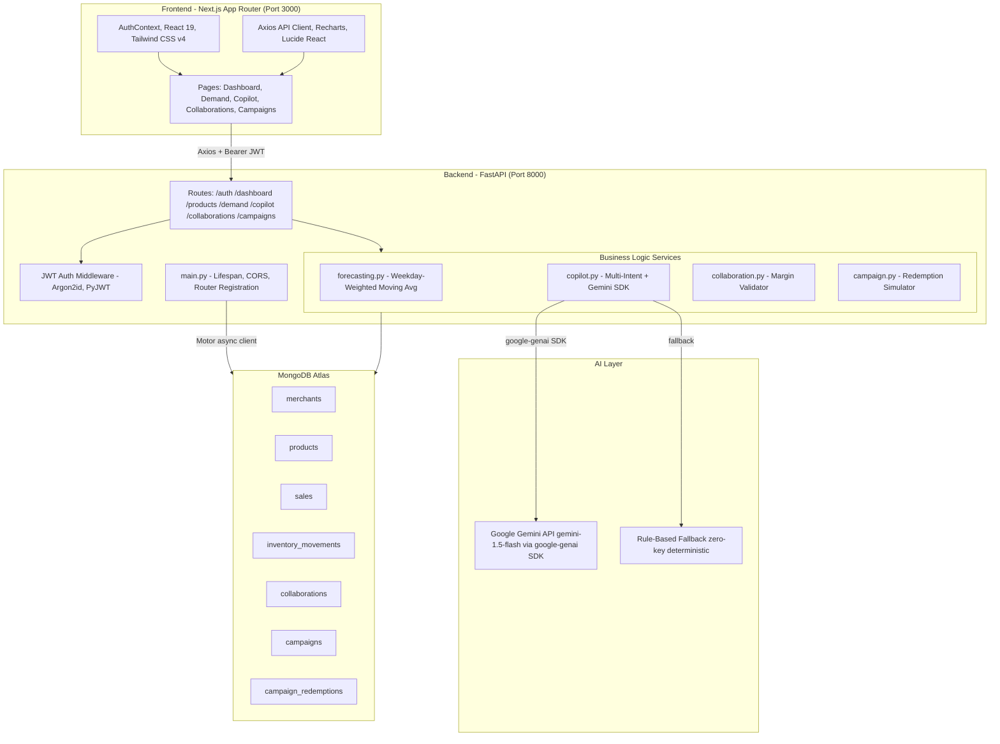

# LocalPulse AI — Merchant Growth Platform

> **Hackathon Prototype** · **Paytm Build for India AI Hackathon** · *Merchant Growth AI Track*

LocalPulse AI is a full-stack, hyper-local demand forecasting and collaborative growth engine built for Indian MSMEs — kirana stores, local cafes, organic produce markets, and neighbourhood retailers. It combines transparent 7-day weekday-aware demand forecasting, real-time stockout prevention, audited inventory replenishment, deterministic margin-validated multi-merchant co-promotions, and a conversational **AI Business Copilot** grounded strictly in live MongoDB sales data powered by Google Gemini.

---

## Table of Contents

1. [System Architecture](#1-system-architecture)
2. [Project Structure](#2-project-structure)
3. [Database Schema](#3-database-schema)
4. [API Reference](#4-api-reference)
5. [Core Modules](#5-core-modules)
6. [AI Business Copilot](#6-ai-business-copilot)
7. [Getting Started](#7-getting-started)
8. [Environment Configuration](#8-environment-configuration)
9. [Demo Merchants](#9-demo-merchants)
10. [Implementation Status](#10-implementation-status)
11. [End-to-End Test Workflows](#11-end-to-end-test-workflows)

---

## 1. System Architecture



### Stack Breakdown

| Layer | Technology |
|:---|:---|
| **Frontend** | Next.js 15 (App Router), React 19, JavaScript, Tailwind CSS v4 |
| **UI Libraries** | Axios, Recharts, Lucide React |
| **Backend** | Python 3.12, FastAPI, Pydantic v2, Uvicorn |
| **Auth** | PyJWT (HS256), Argon2id password hashing (argon2-cffi) |
| **Database** | MongoDB Atlas via Motor (async) + mongomock-motor fallback |
| **AI / LLM** | Google Gemini (google-genai SDK) + rule-based deterministic fallback |
| **Forecasting** | Weekday-stratified weighted moving average (scikit-learn drop-in ready) |

---

## 2. Project Structure

```
LocalPulse/
├── README.md
├── .gitignore
│
├── backend/
│   ├── .env                        # Active environment config (never commit)
│   ├── .env.example                # Documented template
│   ├── requirements.txt
│   ├── .venv/                      # Python virtual environment
│   │
│   └── app/
│       ├── main.py                 # FastAPI app, CORS, lifespan, router mounts
│       ├── seed.py                 # 6-merchant seeder (90 days synthetic data)
│       │
│       ├── core/
│       │   ├── config.py           # Pydantic BaseSettings (reads .env)
│       │   └── security.py         # JWT encode/decode, Argon2id hash/verify
│       │
│       ├── db/
│       │   └── session.py          # Motor async client, index setup, fallback mock
│       │
│       ├── api/
│       │   ├── dependencies.py     # get_current_merchant() JWT dependency
│       │   └── routes/
│       │       ├── auth.py         # /auth/login, /auth/signup, /auth/me, /auth/switch-demo
│       │       ├── dashboard.py    # /dashboard/summary
│       │       ├── products.py     # CRUD /products + inventory adjustments
│       │       ├── demand.py       # /demand/forecast, /demand/sales-history
│       │       ├── copilot.py      # /copilot/chat, /copilot/confirm-action
│       │       ├── collaborations.py
│       │       └── campaigns.py
│       │
│       ├── services/
│       │   ├── forecasting.py      # Weekday-aware demand forecast engine
│       │   ├── copilot.py          # Multi-intent copilot + Gemini SDK integration
│       │   ├── collaboration.py    # Partner discovery + margin validation
│       │   └── campaign.py         # Campaign creation + redemption simulation
│       │
│       └── schemas/                # Pydantic request/response models
│           ├── auth.py
│           ├── product.py
│           ├── sales.py
│           ├── forecast.py
│           ├── dashboard.py
│           ├── collaboration.py
│           ├── campaign.py
│           └── copilot.py
│
└── frontend/
    ├── package.json
    ├── .env.local                  # NEXT_PUBLIC_API_URL=http://localhost:8000
    ├── next.config.mjs
    └── src/
        ├── app/                    # Next.js App Router pages
        │   ├── layout.js
        │   ├── page.js
        │   ├── login/page.js
        │   ├── signup/page.js
        │   ├── dashboard/page.js
        │   ├── demand/page.js
        │   ├── copilot/page.js
        │   ├── collaborations/page.js
        │   └── campaigns/page.js
        ├── components/
        │   ├── layout/Header.js    # Top nav with merchant switcher
        │   └── ui/
        │       ├── StatCard.js
        │       ├── Badge.js
        │       └── Modal.js
        ├── context/AuthContext.js  # Global auth state + JWT management
        └── lib/api.js              # Axios instance + all API call functions
```

---

## 3. Database Schema

All collections live in the **`localpulse`** MongoDB database.

### `merchants`

```js
{
  merchant_id:   String,   // "merch-uuid-..." (primary key)
  business_name: String,   // "Sharma Kirana & General Store"
  owner_name:    String,   // "Ramesh Sharma"
  email:         String,   // unique index
  password_hash: String,   // Argon2id hash
  category:      String,   // "Grocery & Daily Essentials"
  address:       String,   // "12th Main, Indiranagar, Bengaluru"
  phone:         String,
  is_demo:       Boolean,  // true for seeded demo merchants
  created_at:    Date
}
```
**Indexes:** `email` (unique)

---

### `products`

```js
{
  product_id:        String,   // "prod-uuid-..."
  merchant_id:       String,   // FK -> merchants
  name:              String,   // "Amul Taaza Toned Milk 1L"
  category:          String,   // "Dairy"
  cost_price:        Number,   // INR per unit
  selling_price:     Number,   // INR per unit
  current_stock:     Number,   // units on hand
  reorder_threshold: Number,   // low-stock alert trigger
  unit:              String,   // "liters" | "kg" | "packs" | "units"
  created_at:        Date,
  updated_at:        Date
}
```
**Indexes:** `merchant_id`, compound `(product_id, merchant_id)`

---

### `sales`

```js
{
  sale_id:      String,   // "sale-uuid-..."
  merchant_id:  String,   // FK -> merchants
  product_id:   String,   // FK -> products
  date:         String,   // "YYYY-MM-DD"
  units_sold:   Number,
  revenue:      Number,   // units_sold x selling_price
  is_synthetic: Boolean   // true for seeded data
}
```
**Indexes:** compound `(merchant_id, date)`, compound `(merchant_id, product_id, date)`

---

### `inventory_movements`

```js
{
  movement_id:     String,
  merchant_id:     String,
  product_id:      String,
  product_name:    String,
  adjustment_type: String,   // "RESTOCK" | "DAMAGE_LOSS" | "AUDIT_CORRECTION"
  quantity_change: Number,   // positive integer
  stock_before:    Number,
  stock_after:     Number,
  notes:           String,
  created_at:      Date,
  is_synthetic:    Boolean
}
```
**Indexes:** compound `(merchant_id, created_at)`

---

### `collaborations`

```js
{
  proposal_id:             String,
  bundle_name:             String,   // "Morning Breakfast Combo"
  bundle_description:      String,
  initiator_merchant_id:   String,
  initiator_merchant_name: String,
  initiator_product_id:    String,
  initiator_product_name:  String,
  initiator_discount_pct:  Number,
  initiator_margin_pct:    Number,
  initiator_approved:      Boolean,
  partner_merchant_id:     String,
  partner_merchant_name:   String,
  partner_product_id:      String,
  partner_product_name:    String,
  partner_discount_pct:    Number,
  partner_margin_pct:      Number,
  partner_approved:        Boolean,
  original_bundle_price:   Number,
  discounted_bundle_price: Number,
  status:                  String,   // "PENDING_APPROVAL"|"APPROVED"|"REJECTED"|"ACTIVE"
  proposed_duration_days:  Number,
  created_at:              Date,
  updated_at:              Date
}
```
**Indexes:** `initiator_merchant_id`, `partner_merchant_id`

---

### `campaigns`

```js
{
  campaign_id:               String,
  merchant_id:               String,
  title:                     String,
  campaign_type:             String,   // "DISCOUNT_OFFER"|"BUNDLE_COLLABORATION"|"WEEKEND_FLASH"|"LOYALTY_PUSH"
  target_product_ids:        [String],
  collaboration_proposal_id: String,   // optional FK
  discount_pct:              Number,
  budget_allocated:          Number,
  start_date:                String,   // "YYYY-MM-DD"
  end_date:                  String,
  target_redemptions_goal:   Number,
  status:                    String,   // "ACTIVE"|"PAUSED"|"COMPLETED"
  created_at:                Date,
  is_synthetic:              Boolean
}
```
**Indexes:** compound `(merchant_id, status)`

---

### `campaign_redemptions`

```js
{
  redemption_id:     String,
  campaign_id:       String,
  merchant_id:       String,
  product_id:        String,
  units_redeemed:    Number,
  revenue_generated: Number,
  discount_applied:  Number,
  cogs:              Number,
  net_profit:        Number,
  simulated_at:      Date,
  is_simulated:      Boolean   // always true (hackathon demo)
}
```
**Indexes:** `campaign_id`, `merchant_id`

---

## 4. API Reference

Base URL: `http://localhost:8000`
Interactive docs: **`http://localhost:8000/docs`** (Swagger UI)

### Auth — `/api/auth`

| Method | Endpoint | Auth | Description |
|:--|:--|:--|:--|
| POST | `/api/auth/signup` | No | Register a new merchant |
| POST | `/api/auth/login` | No | Login; returns JWT + merchant profile |
| GET | `/api/auth/me` | Yes | Get current authenticated merchant |
| POST | `/api/auth/switch-demo` | No | Instantly switch to any seeded demo merchant |

### Dashboard — `/api/dashboard`

| Method | Endpoint | Auth | Description |
|:--|:--|:--|:--|
| GET | `/api/dashboard/summary` | Yes | KPIs, 30-day trend, 7-day forecast, stockout warnings, growth recommendation |

### Products — `/api/products`

| Method | Endpoint | Auth | Description |
|:--|:--|:--|:--|
| GET | `/api/products` | Yes | List merchant catalog |
| POST | `/api/products` | Yes | Create new product |
| PUT | `/api/products/{id}` | Yes | Update product |
| DELETE | `/api/products/{id}` | Yes | Remove product |
| POST | `/api/products/{id}/adjust-inventory` | Yes | RESTOCK / DAMAGE_LOSS / AUDIT_CORRECTION |
| GET | `/api/products/{id}/movements` | Yes | Inventory movement history |

### Demand & Forecasting — `/api/demand`

| Method | Endpoint | Auth | Description |
|:--|:--|:--|:--|
| GET | `/api/demand/forecast` | Yes | 7-day forecasts for all products |
| GET | `/api/demand/forecast/{product_id}` | Yes | Single product forecast with day-by-day breakdown |
| GET | `/api/demand/sales-history` | Yes | 30-day daily sales history |

### AI Copilot — `/api/copilot`

| Method | Endpoint | Auth | Description |
|:--|:--|:--|:--|
| POST | `/api/copilot/chat` | Yes | Conversational query grounded in live merchant data |
| POST | `/api/copilot/confirm-action` | Yes | Execute confirmed draft action (RESTOCK / CREATE_CAMPAIGN) |

### Collaborations — `/api/collaborations`

| Method | Endpoint | Auth | Description |
|:--|:--|:--|:--|
| GET | `/api/collaborations/discover` | Yes | Discover nearby complementary merchants |
| POST | `/api/collaborations/validate-margin` | Yes | Real-time margin viability check |
| POST | `/api/collaborations/propose` | Yes | Submit a collaboration proposal |
| GET | `/api/collaborations` | Yes | List all proposals involving current merchant |
| POST | `/api/collaborations/{id}/approve` | Yes | Approve as partner |
| POST | `/api/collaborations/{id}/reject` | Yes | Reject proposal |

### Campaigns — `/api/campaigns`

| Method | Endpoint | Auth | Description |
|:--|:--|:--|:--|
| GET | `/api/campaigns` | Yes | List campaigns with live performance metrics |
| POST | `/api/campaigns` | Yes | Create a new promotional campaign |
| POST | `/api/campaigns/{id}/simulate-redemption` | Yes | Simulate N customer redemptions |

---

## 5. Core Modules

### Forecasting Engine (`services/forecasting.py`)

- **Algorithm:** Weekday-stratified weighted moving average over last 30 days of sales
- **Weekend multiplier:** Saturday/Sunday weighted 1.4x vs weekday 1.0x
- **Outputs per product:** `total_forecasted_units`, `total_projected_revenue`, `days_of_inventory_remaining`, `stockout_risk`, `recommended_replenishment_units`, per-day breakdown array
- **Transparency:** Data sufficiency warnings displayed when fewer than 14 days of history are available
- **Extensibility:** Isolated service class — drop in `scikit-learn` or `Prophet` with no API route changes

### Margin Validation Engine (`services/collaboration.py`)

- Enforces **minimum 12% profit margin** for both initiator and partner on all bundle proposals
- Formula: `margin_pct = (discounted_price - cost_price) / discounted_price * 100`
- Returns full unit-level breakdown: original price, discounted price, cost, profit per unit, and `is_financially_viable` flag

### Campaign Simulator (`services/campaign.py`)

- Each simulated redemption writes a `campaign_redemptions` document with per-unit economics (revenue, discount, COGS, net profit)
- ROMS formula: `net_campaign_profit / budget_allocated * 100`
- Baseline comparison derived from 30-day rolling average revenue

---

## 6. AI Business Copilot

Two operating modes — automatically selected based on `LLM_API_KEY` presence:

```
LLM_API_KEY set   -> Try Gemini API -> fallback to rule engine on any error
LLM_API_KEY empty -> Rule engine directly (zero latency, zero cost, offline)
```

### Gemini SDK Integration

```python
from google import genai
from google.genai import types as genai_types

client = genai.Client(api_key=settings.LLM_API_KEY)
response = await client.aio.models.generate_content(
    model="gemini-1.5-flash",
    contents=full_prompt,
    config=genai_types.GenerateContentConfig(
        temperature=0.3,
        max_output_tokens=500,
    ),
)
reply_text = response.text
```

### Intent Routing (Rule Engine)

| Trigger keywords | Response |
|:--|:--|
| `stock`, `restock`, `inventory`, `shortage` | Low-stock analysis + draft `RESTOCK_INVENTORY` action |
| `forecast`, `demand`, `predict`, `next week` | 7-day product forecast summary |
| `campaign`, `offer`, `discount`, `promotion` | Active campaigns + draft `CREATE_CAMPAIGN` action |
| `collab`, `partner`, `bundle`, `neighbor` | Collaboration opportunities summary |
| *(anything else)* | Full merchant business snapshot |

### Confirmed Draft Action Flow

```
Copilot proposes action
  -> Draft card shown to merchant with full payload preview
  -> Merchant clicks "Confirm & Apply"
  -> POST /api/copilot/confirm-action
  -> Audited DB write committed (inventory update or new campaign)
```

No database writes happen without explicit merchant confirmation.

---

## 7. Getting Started

### Prerequisites

- Node.js 18+ and npm
- Python 3.10+ (3.12 recommended)
- MongoDB (optional — falls back to in-memory mongomock-motor automatically)

### Backend Setup

```powershell
cd backend

# Activate virtual environment
.\.venv\Scripts\Activate.ps1        # Windows PowerShell
# source .venv/bin/activate         # macOS / Linux

# Install dependencies
pip install -r requirements.txt

# Configure environment
copy .env.example .env              # Windows
# cp .env.example .env              # macOS / Linux

# Start the server
uvicorn app.main:app --host 127.0.0.1 --port 8000 --reload
```

Backend runs at **`http://127.0.0.1:8000`** — auto-seeds 6 merchants with 90 days of sales data on first launch.

Verify: `curl http://127.0.0.1:8000/health`

### Frontend Setup

```powershell
cd frontend
npm install
npm run dev
```

Open **`http://localhost:3000`**

---

## 8. Environment Configuration

### `backend/.env`

```env
# MongoDB Atlas or local
MONGODB_URI=mongodb://localhost:27017
DATABASE_NAME=localpulse

# JWT signing secret
JWT_SECRET=your-super-secret-key-here

# CORS - allowed frontend origin
FRONTEND_URL=http://localhost:3000

# Google Gemini AI (optional — rule engine works without it)
# Get a FREE key at: https://aistudio.google.com/app/apikey
# Real Gemini keys start with "AIza..."
LLM_API_KEY=AIzaSy...
LLM_PROVIDER=gemini
LLM_MODEL=gemini-1.5-flash
LLM_BASE_URL=
```

> If `LLM_API_KEY` is empty, the copilot runs entirely on the deterministic rule engine — no network calls, no API cost, works fully offline.

### LLM Provider Options

| `LLM_PROVIDER` | Integration | Key format |
|:--|:--|:--|
| `gemini` | `google-genai` SDK (async native) | `AIzaSy...` |
| `openai` | httpx REST to OpenAI API | `sk-...` |
| `groq` | httpx REST + `LLM_BASE_URL` | `gsk_...` |
| `custom` | httpx REST + `LLM_BASE_URL` | any |

### `frontend/.env.local`

```env
NEXT_PUBLIC_API_URL=http://localhost:8000
```

---

## 9. Demo Merchants

Six fictional merchants seeded in **Indiranagar, Bengaluru**:

| Merchant | Category | Email | Demo Scenario |
|:---|:---|:---|:---|
| **Sharma Kirana & General Store** | Grocery & Daily Essentials | `sharma.kirana@localpulse.demo` | High milk turnover, active low-stock alerts, running discount campaign |
| **Chai Point & Baker's Corner** | Cafe & Bakery | `priya.bakery@localpulse.demo` | Artisan breads, pending Morning Breakfast Bundle collaboration |
| **Green Valley Organic Produce** | Fresh Fruits & Vegetables | `greenvalley@localpulse.demo` | Perishable produce, tight reorder margins, seasonal demand spikes |
| **Modern Threads & Apparel** | Fashion & Textiles | `modernthreads@localpulse.demo` | High-margin handloom apparel, weekend demand multiplier |
| **Sanjeevani Ayurvedic Wellness** | Health & Wellness | `sanjeevani@localpulse.demo` | Immunity supplements, Diwali demand spike scenario |
| **Anand Sweets & Savories** | Traditional Sweets & Snacks | `anandsweets@localpulse.demo` | Festive confectioneries, gift box bundles |

**Default password for all accounts:** `password123`

Use the **Demo Merchant Switcher** dropdown in the top navigation bar to switch instantly.

---

## 10. Implementation Status

| Component | Status | Notes |
|:---|:---|:---|
| **JWT Authentication** | Implemented | Argon2id hashing, server-derived identity, 7-day token expiry |
| **Demand Forecasting** | Implemented | Weekday-stratified baseline; scikit-learn drop-in ready |
| **AI Copilot (Rule Engine)** | Implemented | 5-intent router, draft actions with confirmation, evidence citations |
| **AI Copilot (Gemini)** | Implemented | google-genai async SDK; graceful auto-fallback |
| **Margin Validation Engine** | Implemented | Exact unit-level math, 12% minimum enforced per participant |
| **Multi-Merchant Collaborations** | Implemented | Proposal to partner approval workflow |
| **Campaign Simulator** | Implemented (synthetic) | Deterministic redemptions persisted to MongoDB |
| **Inventory Audit Trail** | Implemented | Every stock change logged with before/after snapshot |
| **MongoDB Auto-Fallback** | Implemented | mongomock-motor in-memory if Atlas connection fails |
| **Seeded Sales Data** | Synthetic | 90-day transactions, clearly labelled `is_synthetic: true` |
| **Payment / Soundbox Integration** | Out of Scope | Excluded per hackathon track guidelines |

---

## 11. End-to-End Test Workflows

### 1. Login & Dashboard
```
http://localhost:3000/login
  Click "Sharma Kirana & General Store" (1-click login)
  Review 30-day sales chart, 7-day forecast chart, stockout warnings
```

### 2. Restock via Dashboard
```
Dashboard -> Stockout Warnings table
  Click "Restock (+50)" on Amul Taaza Milk
  Confirm the replenishment
  Inventory balance and days-of-runway update immediately
```

### 3. AI Copilot Draft Action
```
/copilot
  Type "Which products are running low?" or click the suggestion chip
  Copilot replies with grounded DB evidence citations
  Click "Confirm & Apply" on the RESTOCK draft action card
  Stock update committed to MongoDB with full audit log
```

### 4. Approve Multi-Merchant Collaboration
```
/collaborations  (logged in as Sharma Kirana)
  View proposed Morning Breakfast Bundle with Chai Point & Baker's Corner
  Header dropdown -> Switch to "Chai Point & Baker's Corner"
  Click "Approve Collaboration" as the partner merchant
  Status updates to APPROVED for both merchants
```

### 5. Campaign Simulator
```
/campaigns
  Click "+5 Redemptions" on the active discount campaign
  Observe live recalculation: redemptions, revenue, net profit, ROMS %
  Click "Launch New Campaign" to create a custom promotion
```

---

## License

Hackathon prototype — built for the **Paytm Build for India AI Hackathon 2026**, Merchant Growth AI track.
